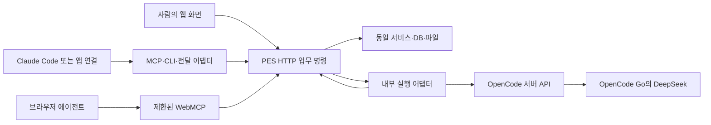

# 1단계 ② API 형식 — Codex 의견안

작성일: 2026-11-04. 관련 이슈: **SEL-22**. 이 문서는 제안이며 HTTP 서버·MCP·OpenCode 접속을 구현하거나 검증한 보고가 아니다. 저장소의 문서·DDL·코드만 읽었고 실제 `~/pes-projects`·`~/.pes/`는 읽지 않았다. 예시는 모두 합성이다.

**추천: HTTP의 검증된 업무 명령을 원본으로 두고, 웹·CLI·MCP·WebMCP가 같은 명령을 호출한다.** 에이전트는 결과·질문을 제출하고 PES가 권한·상태·버전·lease·정책을 검증해 저장한다. DB의 열을 임의로 수정하는 범용 API는 제공하지 않는다.

확정된 전송 기본 켜짐/프로젝트별 끄기, A의 DeepSeek 한 모델·6단계, B의 Claude Code+Claude 앱, 공개 저장소·매 PR CI와 DB 결정 17개는 그대로 따른다. 옛 OpenCode 의견의 모델별 역할 배정·A 범위 축소·기본 꺼짐·파일 쓰기 병행은 채택하지 않는다.

근거: [stage-0.md:14, 42–48, 85–99](../stage-0.md#L14-L99), [stage-1-db.md:14–34](../stage-1-db.md#L14-L34). 이하의 경로·필드·제한값은 이번 추천이다.

## 1. 생각할 주제와 결정 방법

| 주제·정할 것 | 선택지 | 판단 기준 | 추천과 이유 |
|---|---|---|---|
| 통로·업무 경계 | HTTP / MCP 원본 / 파일 | 모든 실행기·웹이 같은 검증을 쓰는가 | HTTP 원본, 나머지는 얇은 어댑터. 공급자·도구별 상태 분기를 줄임 |
| 쓰기 형태 | 표 CRUD / 임의 ops / 업무 명령 | 승인·버전·인계 규칙을 우회할 수 있는가 | `result.submit`, `stage.approve` 등 닫힌 동작 목록. DTO를 DB 열과 분리 |
| 형식 버전 | URL만 / 봉투만 / 역할 분리 | DB 버전과 혼동하지 않고 이전 가능한가 | `/api/v1`은 호환성 큰 경계, 봉투 `format_version`은 1.x 형식. DB·workflow 버전은 별개 |
| 맥락 | 전체 프로젝트 / 요약+필요 상세 | 토큰·자료 반출·변경 충돌을 줄이는가 | 정확한 버전 manifest+요약을 기본, 본문은 선택 조회. 삭제·변경을 조용히 누락하지 않음 |
| 실행·소유권 | 세션=라운드 / run+lease / 항목별 병렬 | 종료·인계·늦은 결과를 구분하는가 | run·lease·fence 분리, 프로젝트 담당 하나. 실행 세션 ID는 부가 정보 |
| submit | 항목별 즉시 / 작은 원자 묶음 / 전체 프로젝트 | 부분 저장 없이 사람이 검토할 수 있는가 | 작은 원자 묶음. 결과·출처·의견 반영 영수증을 함께 채택 |
| 질문·답 | 딕셔너리 / 버전 객체 / 공급자 폼 | 당시 문구·옵션·의견이 남는가 | PES 질문/폼 버전과 답 버전, 질문별 의견을 구분. 실행 권한 질문은 별도 |
| 대기·처리 확인 | 무한 연결 / 짧은 poll / 즉시 SSE 필수 | 앱 종료 후 재개되고 처리 누락이 없는가 | 짧은 poll 기본, 상태 전이와 읽기를 분리. seen≠applied, cursor≠처리 영수증 |
| 충돌·멱등 | 마지막 쓰기 / rev만 / rev+fence+요청 키 | 중복·오래된 결과·응답 유실을 막는가 | 각 역할을 모두 적용하고 같은 DB 트랜잭션에서 검증. 0행 UPDATE는 실패 |
| 중단·인계 | 연결 종료=취소 / 명시 명령 | 외부 프로세스와 DB 상태의 차이가 보이는가 | 취소/일시 중단/인계를 구분. DB 결과 채택 차단과 외부 중단 확인을 따로 표시 |
| 인증·사람 동작 | Origin만 / 프로젝트 토큰 / 완전한 로그인 선행 | 실제 수행자와 소유자 권한이 구분되는가 | 2단계 프로젝트 토큰+로컬 소유자 세션. 사람 로그인 UI는 5단계대로 유지 |
| 변경분 | 파일 수정 시각 / 사건 커서 / 전체 이벤트 소싱 | 같은 tx·복원·권한 변경을 처리하는가 | DB 인스턴스·epoch·범위에 묶인 커서. 현재 값+불변 버전은 유지 |
| WebMCP | 모든 동작 / 읽기만 / 제한적 허용 | 대리 에이전트가 사람 승인으로 오인되는가 | 읽기·초안·질문/첨언 추가만 제한적으로. 승인·reopen·판 시작·삭제는 노출 금지 |
| 외부 내보내기 | 왕복 동기화 / 선택적 한 방향 | 연구 정본·전송 범위를 지키는가 | PES가 원본, 명시 선택한 버전만 전달. 외부 결과는 전달 영수증으로만 저장 |
| 구현 분해 | API별 새 이슈 / 기존 PR에 귀속 | 22개 PR과 중복·누락이 없는가 | 기존 PR 4·5·10·13·14·19·20·21 등에 귀속. 2단계 새 이슈 0개 예상 |

근거: [DB:38–117, 158–198](../stage-1-db.md#L38-L198), [Notion·Linear:149–164](../research/notion-linear.md#L149-L164), [WebMCP:17–38](../research/webmcp.md#L17-L38), [OpenCode 초안:872–899](stage-0-opencode.md#L872-L899). 세부 추천은 아래에서 검증 가능한 약속으로 풀었다.

## 2. HTTP 계약 초안

### 2.1 경로·버전·공통 봉투

- 기본 경로는 `/api/v1/projects/{project_id}`이며 아래 표에서는 **P**로 줄인다. ID는 불변 식별자, slug·Q-12 같은 번호는 조회·표시용 별칭이다. run·버전·blob의 프로젝트 일치를 서버가 매번 확인한다.
- JSON 요청/응답은 UTF-8, `format_version:"1.0"`. URL의 v1은 비호환 변경 때 올린다. 1.x 응답은 선택 열 추가 중심, 필수 입력·기존 의미·권한을 바꾸는 변경은 새 큰 버전이다. 기능은 capabilities로 확인한다.
- 요청의 모르는 필드는 거부해 오타·actor 위조를 찾는다. 응답의 모르는 부가 열은 무시할 수 있지만 모르는 정책·중요 상태를 허용으로 추측하지 않는다. DB `schema_version`, 사건 `schema_version`, run `workflow_version`은 이 형식 버전과 별개다.
- ID는 문자열, `rev/control_rev/fence/event_seq`도 10진 숫자 **문자열**로 전달해 큰 정수 손실을 피한다. DB에는 범위를 검사해 INTEGER로 저장한다. 시각은 DB 합의대로 UTC epoch ms 정수, 본문은 Markdown 또는 blob 참조다.
- 쓰기에는 `Idempotency-Key` 필수. MCP 인자의 `idempotency_key`를 이 헤더로 매핑한다. 같은 값을 본문에도 중복 기입하지 않는다. `expected`가 쓰기 전제의 원본이고 GET 캐시 검증자와 혼동하지 않는다.
- 성공 봉투는 `{format_version,data,meta}`. meta에 request_id·tx_id(변경 시)·commit_cursor·replayed·서버가 확정한 performed_by를 둔다. 201은 새 자원, 200은 동기 명령 완료/읽기, 202는 **요청의 영속 저장**이며 외부 실행 완료가 아니다.
- 실패 봉투는 `{format_version,error}`. HTTP 성공 코드에 실패 문자열만 넣지 않는다. 페이지/전송 제한 초안은 JSON 256KiB, 결과 20개/묶음, 목록 기본 100개, wait 25초 이하이며 실제 제한은 capabilities로 공지·시험한다. 큰 파일은 별도 경로다.

근거: [DDL:79–110](../schemas/stage-1-ddl-draft.sql#L79-L110), [275–318](../schemas/stage-1-ddl-draft.sql#L275-L318), [903–954](../schemas/stage-1-ddl-draft.sql#L903-L954). 현행 HTTP는 본문을 받아 파일에 저장하는 수준이다([serve.py:111–152](../../../scripts/serve.py#L111-L152)); 새 계약의 보장과 구분한다.

### 2.2 동작·경로·권한·WebMCP 노출 표

H=직접 수행하는 사람, E=프로젝트 토큰의 내부/외부 에이전트, W=브라우저 에이전트다. E는 자신의 run·할당 범위 안에서만 쓸 수 있다. W 허용은 브라우저 기능 지원을 보장한다는 뜻이 아니라 **향후 노출 허용 목록**이다. 위험도는 도구 주석과 별개로 서버에서 검사한다.

| 동작 | HTTP 초안 | 호출자·핵심 조건 | WebMCP·위험도 |
|---|---|---|---|
| capability 조회 | `GET /api/v1/capabilities` | 인증된 H/E/W; 버전·제한·지원 동작 | 가능·읽기 |
| 맥락·버전 상세 | `GET P/context`, `GET P/objects/{o}/versions/{v}` | H/E/W, 목적·범위 검사; Go 토큰은 run 필수 | 선택 범위만 가능·읽기/내용 민감 |
| 실행 시작 | `POST P/runs` | H가 A 시작 요청; ON이어도 자동 시작하지 않음 | 불가·높음 |
| 담당 획득·재개 | `POST P/claims` | E 또는 명시적 B 전달 세션; control_rev·대상·lease 검사 | 불가·높음 |
| heartbeat | `POST P/runs/{r}/heartbeat` | 현재 담당, lease_id/fence 확인 | 불가·운영 제어 |
| 결과 제출 | `POST P/runs/{r}/results` | 담당 E, rev·상태·근거·정책·입력 영수증 검사 | 불가·높음 |
| 질문 게시 | `POST P/questions` | E는 담당 run에 묶음, H/W는 현재 범위에 추가 | 추가만 가능·중간 |
| 질문 수정·보류·합치기 | `POST P/questions/{q}/revisions` | H 또는 허가된 담당 E; 원문·기존 답 보존 | 초기 노출 안 함·중간 |
| 답 초안 | `PUT P/answer-drafts/{draft_id}` | H/W; draft 전용, 제출·승인과 구분 | 가능·낮음 |
| 답/자유 의견 제출 | `POST P/submissions` | H는 사람 대상 질문, E는 자신에게 온 질문에 답; 버전 고정 | 제출은 불가·중간 |
| 대기 상태로 전환 | `POST P/runs/{r}/wait` | 담당, 미완료 쓰기 없음; lease 해제 | 불가·운영 제어 |
| 답·의견 기다리기 | `GET P/runs/{r}/inputs?cursor=…&wait_ms=…` | 해당 run 접근권, 순수 읽기 | 현재 선택 질문 읽기만 별도 도구로 가능 |
| 입력 읽음/미반영 확인 | `POST P/runs/{r}/input-receipts` | E, seen/ignored+사유만; applied는 results와 함께 | 불가·중간 |
| run 완료 | `POST P/runs/{r}/complete` | 현재 담당, 미처리/미완료 상태 점검 | 불가·높음 |
| 일시 중단·취소 | `POST P/runs/{r}/interrupt`, `/cancel` | H 또는 자신의 담당 E; 결과 채택 차단 | 불가·높음 |
| 인계 | `POST P/runs/{r}/handoffs` | 현재 담당 또는 H의 명시적 인계 | 불가·높음 |
| 명령·중단 처리 조회 | `GET P/requests/{key}`, `GET P/operations/{id}` | 인증 actor·프로젝트 범위로 조회 | 일반 W 노출 안 함 |
| 변경분 | `GET P/changes?cursor=…` | H/E/W; 범위·권한·epoch 검사 | 선택 범위만 가능·읽기 |
| 파일 예약·업로드·확정 | `POST P/uploads`, `PUT` 제공 경로, `POST P/uploads/{u}/complete` | H/E; 파일 크기·hash·목적 검사 | 초기 불가·중간 |
| 파일 읽기 | `GET P/files/{blob_id}/content` | H/E; 버전 참조·프로젝트·현행 Go 정책 검사 | 초기 불가·내용 반출 |
| 첨언·답글 추가 | `POST P/threads`, `POST P/threads/{t}/messages` | H/E/W; 인용·문맥·대상 버전 고정 | 가능·중간 |
| 첨언 해결·후속 적용 | `POST P/threads/{t}/resolutions`, `POST P/followups/{f}/apply` | 허가된 H/E; 실제 결과와 연결. reopen 적용은 H만 | 초기 불가·높음 |
| 가정·결정·반영 기록 | `POST P/assumptions`, `/decisions`, `/reflections` 및 명시적 revisions | H/E는 역할별 제안·평가·근거 제출; 정책 변경과 분리 | 초기 불가·중간/높음 |
| 라운드 시작 | `POST P/stages/{s}/rounds` | H 또는 허가된 워크플로 E; 현재 단계·답·이전 봉인·rev 검사 | 불가·높음 |
| 라운드 봉인 | `POST P/rounds/{round}/seal` | 담당 E/H, 정확한 manifest 채택; 단계 승인은 아님 | 불가·높음 |
| 단계 승인·reopen | `POST P/stages/{s}/approve`, `/reopen` | **H만**, snapshot·rev·직접 확인 증거 | **노출 금지**·높음 |
| 실행 도구 권한 응답 | `POST P/runs/{r}/permissions/{permission}/decisions` | 실행 정책 안의 H 확인; 공급자 권한 요청과 일치 | 불가·높음 |
| 판 시작 | `POST P/editions` | **H만**, 기준 snapshot·활성 판 규칙 | **노출 금지**·높음 |
| Go 정책 변경 | `POST P/policies/opencode-go/revisions` | **소유자 직접 조작**, 정책 버전·control_rev | 불가·높음 |
| 토큰 관리·archive·영구 삭제 | `POST P/agent-tokens`, `/archive`, `/purge` 등 분리 | 소유자, 별도 범위·확인; 영구 삭제는 후속 단계 | 불가·높음 |
| 선택적 외부 내보내기 | `POST P/exports` | H가 목적·대상·버전을 선택; 외부 자격정보는 서버 측 | 불가·외부 반출/높음 |

3·4·5·6단계 기능의 경로는 계약 방향이며 2단계에 모두 구현하지 않는다. capabilities에 미지원 동작을 표시하고, 아직 없는 동작에 성공/가짜 job을 반환하지 않는다. 이 목록에서 MCP/WebMCP는 허가된 부분만 감싼다.

근거: [DB:28–32, 158–163, 178–198](../stage-1-db.md#L28-L198), [WebMCP:19–37](../research/webmcp.md#L19-L37), [DDL:252–272](../schemas/stage-1-ddl-draft.sql#L252-L272). 임의 `ops/path/value` 제안([Notion·Linear:160–162](../research/notion-linear.md#L160-L162))은 동작의 원자성을 참고하되 DB 임의 쓰기 권한으로 채택하지 않는다.

### 2.3 맥락·claim·할당 범위

1. 읽기 권한으로 current scope의 요약·열린 질문·가정/결정·미반영 입력·최근 반영 내역을 받는다. `context`는 선택한 판/단계/라운드, control_rev, 대상별 rev/version_id, workflow_version, 고정 manifest와 변경 커서를 반환한다.
2. `claims`에 scope, 대상 object_id와 기준 rev/version_id, expected.control_rev를 보낸다. 새 run 생성 또는 `resume_run_id`를 명시한다. actor·A/B·provider·A의 모델은 서버의 등록/어댑터 설정으로 확정한다.
3. 서버는 유효 lease가 비었거나 만료됐는지 같은 트랜잭션에서 검사하고 새 lease_id·증가한 fence·expires_at을 반환한다. 남의 활성 담당이면 `409 lease_busy`, 자동 강제 탈취하지 않는다.
4. claim 응답의 맥락 manifest를 기준으로 작업한다. claim 전 읽은 내용이 바뀌었으면 다시 읽는다. 시작 질문은 round_id=NULL일 수 있고 잘못된 가상 R0을 만들지 않는다.
5. 새 항목 생성은 명시한 stage와 허용 kind 안에서만 가능하다. caller의 client_ref는 그 요청 안에서만 쓰며 실제 object/version ID·표시 번호는 서버가 만든다. 기존 항목을 바꾸려면 run_targets와 기준 rev에 있어야 한다.

본문 전체·키·다른 프로젝트·불필요한 로컬 경로를 context에 싣지 않는다. 큰 본문은 버전/blob 참조로 내려주며, 제한 때문에 일부가 빠지면 has_more·다음 조회 경로를 명시한다. 요약을 출처 원문 전체라고 표시하지 않는다. 원고·외부 자료는 신뢰할 수 없는 내용으로 표시하고 시스템 명령으로 승격하지 않는다.

context의 manifest/커서는 같은 짧은 DB 읽기 트랜잭션에서 만든다. D1의 순차 읽기 일관성만으로 여러 조회가 같은 snapshot이라고 가정하지 않고, 원자 read batch 또는 고정 버전 manifest 방식을 PR2에서 확인한다. 고정 ID의 본문은 나중에 읽어도 같은 내용이어야 한다.

근거: [DB:38, 58–68, 107–117](../stage-1-db.md#L38-L117), [DDL:823–886](../schemas/stage-1-ddl-draft.sql#L823-L886), 현행 압축 읽기·재개 [commands/run.md:11–14](../../../commands/run.md#L11-L14), [skills/core:86–91](../../../skills/core/SKILL.md#L86-L91).

### 2.4 submit 봉투와 한 번의 채택

`POST P/runs/{r}/results`, `Idempotency-Key: req_demo_submit_1`의 합성 예시다. 쓰기 DTO는 artifact 전체 내용 버전을 나타내며 필수 필드 누락은 422다. 빈 배열/빈 문자열은 명시적 비움, null은 해당 타입에서 허용할 때만 사용한다. 원고 citations는 전체 순서 목록으로 교체한다.

```json
{
  "format_version": "1.0",
  "scope": {"edition_id": "e_demo", "stage_id": "s_demo", "round_id": "round_demo"},
  "expected": {"control_rev": "7", "objects": [{"object_id": "o_demo", "rev": "3", "version_id": "v_demo"}]},
  "lease": {"lease_id": "lease_demo", "fence": "12"},
  "results": [{"client_ref": "r1", "object_id": "o_demo", "artifact_kind": "section", "document": {
    "title": "가상 절", "summary": "합성 요약", "body": {"format": "markdown", "text": "합성 본문"},
    "status": "done", "citations": [], "files": []
  }}],
  "input_receipts": [{"input_version_id": "answer_v_demo", "disposition": "applied", "result_client_refs": ["r1"], "rationale": "합성 의견을 반영함"}]
}
```

- scope와 URL/run의 소속, 모든 참조 버전·파일, 대상별 rev와 현재 제어 상태를 검사한다. actor·via·tx_id·표시 번호·version_no를 caller가 지정해 사실로 만들 수 없다.
- 출처는 기존 source_version_id 또는 요청 안의 새 출처 client_ref로 연결한다. 새 출처에는 locator·확인 시점/방법·발췌·판정을 받고 실제 제출자를 기록한다. URL만으로 합치지 않고, 원문을 못 읽었는데 발췌를 만들거나 AI 보고를 사람 확인으로 바꾸지 않는다.
- 새 버전·출처/각주·관계·round_contents·반영 내역·applied 영수증·현재 포인터·사건·mutation 영수증을 한 트랜잭션에 넣는다. 묶음 하나라도 실패하면 전부 거절한다. 큰 결과는 blob 업로드 또는 별도 작은 묶음으로 나눈다.
- 이미 다른 run이 반영한 input_version을 다시 적용하려면 충돌로 알리고 재검토 작업을 명시한다. run별 영수증 PK만 믿고 인계 후 같은 의견을 두 번 적용하지 않는다. 새 검토는 새 작업 근거로 남긴다.
- 응답은 client_ref→object_id/version_id/new_rev, tx_id, commit_cursor, 수행자, 경고 코드다. 긴 결과 본문을 영수증에 복제하지 않는다. 저장·채택 성공은 단계 승인/보고서 공개 성공과 다르다.

근거: [DB:24–27, 67–76, 110–122, 211](../stage-1-db.md#L24-L211), [DDL:294–318](../schemas/stage-1-ddl-draft.sql#L294-L318), [889–927](../schemas/stage-1-ddl-draft.sql#L889-L927). 현행 merge의 URL 누적·원고 출처 교체·depth 증가([pes.py:334–362](../../../scripts/pes.py#L334-L362))는 호환 어댑터에서 해석하며 새 API의 재시도로 반복 증가시키지 않는다.

### 2.5 질문·답·대기·complete

| 명령 | 요청의 핵심 | 서버가 보장할 결과 |
|---|---|---|
| 질문 게시/수정 | scope/run, 질문의 text/type/options/default_value/importance/required/allow_comment_as_answer/show_if, 기존 질문이면 expected rev | 원문·수정 버전·폼 순서 고정. show_if는 안정된 question_id를 참조하고 같은 폼/순환/기본값 타입 검사 |
| 제출 봉투 | set_id, 각 question_id+question_version_id+value 또는 question_comment, 자유 note, 버전 전제 | 당시 질문에 대한 답+질문별 메시지+자유 의견 보존. 덧붙임을 기본값 동의로 바꾸지 않음 |
| wait 전이 | expected control_rev, 현재 lease/fence, 대기할 질문/입력 범위 | run=waiting_human, lease 해제, 기준 커서 반환. 미제출 결과는 서버 저장으로 추정하지 않음 |
| inputs 조회 | cursor, wait_ms; 같은 run 접근권 | 답·질문 의견·요청 버전과 현재 처리 상태. 새 입력 없으면 200+빈 배열+커서, heartbeat/ack 부작용 없음 |
| receipt | input_version_id, seen 또는 ignored+사유 | 읽음/명시적 미반영만 저장. applied는 결과·후속 조치와 같은 명령에서만 |
| complete | expected, lease/fence, status=succeeded/failed, 짧은 요약, 산출 version IDs | run 종료·lease 해제·사건 기록. 미반영 입력/작업을 드러내며 stage 상태·사람 승인에는 손대지 않음 |

필수 질문도 `allow_comment_as_answer=1`이면 의견만으로 응답 가능하다. 구 폼의 `__other`는 호환 계층에서 질문 의견으로 바꾼다. 같은 단어의 qid라도 다른 폼/라운드 버전을 섞지 않는다. 질문을 수정한 뒤 옛 질문에 대한 새 제출은 `409 question_version_changed`로 알려 입력 초안을 보존하고 재확인하게 한다. 옛 답 자체를 삭제하지 않는다.

inputs 조회 성공은 처리 완료가 아니다. `wait`를 다시 호출해도 동일 키이면 같은 전이 결과이며, 그 뒤 GET은 최신 입력을 읽는다. 앱이 닫혀도 질문·답·영수증은 남는다. 답이 오면 같은 actor가 다시 claim해 최신 맥락·fence를 받고 이어간다. 페이지를 읽지 않은 입력까지 complete로 일괄 mark하지 않는다.

라운드 seal은 정확한 버전 manifest를 닫는 별도 동작이다. complete가 이를 암묵적으로 대신하지 않는다. 봉인 뒤 도착한 의견은 수신 기록을 남겨 다음 라운드 작업으로 분류하며 옛 snapshot을 바꾸지 않는다. 다음 라운드 시작은 현재 단계·사람 답·워크플로 전제를 검사하는 명령으로 수행한다.

사람의 `approve`는 scope·snapshot_id·expected.control_rev/stage_rev·남은 일 이월 선택을 받는다. 현재 검토 대상과 다른 snapshot, 미처리 입력을 숨긴 승인, 에이전트 토큰의 요청을 거부한다. 성공 시 승인 기록·현재 승인 포인터·다음 단계 asking·필요한 이월 작업·control_rev·사건을 함께 저장한다. 최종 단계는 여섯 단계의 유효 승인/stale를 확인해 판 완료로 전이한다.

`reopen`은 수정 요청과 현재 rev를 받아 해당 단계의 현재 승인 포인터를 해제하고 새 라운드를 준비하며, 영향받는 뒤 단계 stale·판 완료 해제·control_rev를 함께 바꾼다. 과거 approvals/snapshot은 지우지 않는다. 기존 실행은 이전 control_rev로 더 쓰지 못하고 새 맥락을 받아야 한다. 단계 시작/다음 단계 settings도 제출된 답의 정확한 버전에서 명령이 반영하며, 에이전트가 임의 settings JSON을 직접 덮어쓰지 않는다.

근거: [DB:24, 32, 82–89, 182–190, 209–211](../stage-1-db.md#L24-L211), [DDL:468–575](../schemas/stage-1-ddl-draft.sql#L468-L575), [889–900](../schemas/stage-1-ddl-draft.sql#L889-L900), 현행 [pending/mark:516–563](../../../scripts/pes.py#L516-L563), [폼 봉투:96–100](../../../templates/ask.html#L96-L100).

### 2.6 rev·멱등·0행 실패·오류

쓰기 전제는 `expected.control_rev`와 변경 대상의 `rev/version_id`다. 에이전트 결과에는 현재 run·lease_id·fence·미만료·허용 상태도 필수다. 보통 답·첨언은 자기 집합만 변경하며 lease를 요구하거나 전체 control_rev를 올리지 않는다. 승인·reopen·판 전환·정책 변경은 control_rev를 바꾼다. heartbeat는 내용 rev를 올리지 않는다.

1. 매 요청마다 인증·권한·현행 정책을 먼저 확인한다. 그다음 `(project_id,actor_id,Idempotency-Key)`의 완료 영수증을 찾는다. 같은 의미 요청이면 기존 결과를 반환하고, 다른 요청이면 `409 idempotency_key_reused`다.
2. 요청 hash에는 메서드·경로·형식 버전·scope·전제·lease·정규화한 JSON을 포함한다. 배열 순서는 유지하고 중복 JSON 키는 거부한다. 인증 헤더·전송 시각·request_id는 hash에서 제외한다. 의미가 달라진 재시도는 새 키다.
3. 새 명령은 **같은 DB 트랜잭션 안에서** rev·fence·소속·상태·정책을 다시 검사한다. SQLite는 0행이면 예외→전체 rollback, D1은 같은 batch 안의 가드/제약 실패로 전체 rollback되게 한다. 사전 SELECT만 비교하거나 0행 뒤 다른 INSERT를 commit하지 않는다.
4. 버전·포인터·입력 반영·사건·응답 영수증은 함께 commit한다. 서버 ID/자동 생성 시각은 commit 결과에만 확정한다. 성공 이력의 키는 프로젝트 기록 보존 기간 동안 재사용하지 않는다. rollback된 요청은 완료 영수증을 남기지 않는다.
5. 응답 유실/5xx는 원래 키·본문으로 조회/재시도한다. `GET requests/{key}`가 아직 404여도 다른 요청이 진행 중일 수 있으므로 새 키로 즉시 재제출하지 않는다. rev 충돌을 최신 rev만 붙여 같은 옛 본문으로 자동 강제하지 않는다.
6. 재응답도 현재 권한으로 검사한다. Go OFF 뒤 cached context/파일을 다시 내보내지 않는다. 쓰기 영수증은 ID·hash·상태 중심으로 제한해 예전 연구 본문을 통한 우회를 막는다. replay는 새 버전·사건·depth를 만들지 않는다.

완료 영수증의 replay는 새 명령의 rev/lease/일회성 intent 소모 검사보다 먼저 처리한다. 이미 완료한 명령은 이후 run 종료·인계로 lease가 바뀌었다고 재실행하지 않는다. 다만 토큰 회수·현행 읽기 권한·반출 정책 검사는 replay에도 적용한다. 실패를 고쳐 다시 보낼 때는 새 키를 쓰며, 이전 명령의 commit 여부가 불명확하면 먼저 같은 키로 확인한다.

```json
{"format_version":"1.0","error":{"code":"rev_conflict","message":"기준 버전이 바뀌었습니다. 맥락을 다시 확인해 주세요.","request_id":"req_demo","retryable":false,"retry":{"kind":"refresh_context"},"details":{"object_id":"o_demo","expected_rev":"3","current_rev":"4"}}}
```

| HTTP·code | 의미·다음 행동 |
|---|---|
| 400 `invalid_json` / `unsupported_format_version` | 해석 불가·지원 형식 밖. 수정 후 새 요청 |
| 401 `unauthenticated` | 토큰 누락·만료·회수. 자격정보를 갱신 |
| 403 `scope_denied` / `human_required` / `policy_blocked` | 권한·직접 사람 동작·Go 정책 위반. 자동 재시도하지 않음 |
| 404 `not_found` | 접근 가능한 범위에 자원 없음. 다른 프로젝트의 존재를 상세히 누설하지 않음 |
| 409 `rev_conflict` / `control_rev_conflict` / `question_version_changed` | 맥락·입력을 보존하고 최신 버전을 다시 확인 |
| 409 `lease_busy` / `lease_expired` / `fence_stale` / `run_not_writable` | 기다리기·재claim·인계 필요. 현재 결과 채택 금지 |
| 409 `idempotency_key_reused` / `input_already_applied` | 기존 결과 확인, 다른 작업이면 새 근거·새 키 |
| 409 `cursor_reset_required` | epoch/범위/보존 경계가 달라 현재 snapshot부터 다시 받기 |
| 413 / 415 / 422 `payload_too_large` / `unsupported_media_type` / `validation_failed` | blob 분리·타입/필수/관계 수정. 422는 JSON 경로별 코드 제공 |
| 428 `precondition_required` | 필요한 expected/lease가 없음. 맥락을 읽어 조건 추가 |
| 429 `rate_limited` / 503 `temporarily_unavailable` | Retry-After와 지수 대기. 같은 키 유지 |
| 500 `internal_error` | tx 상태 조회 후 같은 키 재시도. SQL·경로·키·본문을 오류에 노출하지 않음 |

`retryable`은 **같은 요청을 자동 재시도해도 되는가**다. 문구는 한국어, code·JSON 경로는 안정된 기계 식별자다. 권한 없는 caller에게 현재 내용·잠금 소유자 개인정보를 반환하지 않는다. DB 오류를 모두 409로 뭉개지 않고 검증·권한·경쟁·내부 결함을 구분한다.

근거: [DB:111–124, 160, 169–170, 215](../stage-1-db.md#L111-L215), [DDL:79–110, 872–927](../schemas/stage-1-ddl-draft.sql#L79-L927), 기존 SQL 설계 실험 [check_ddl.py:434–493](../schemas/check_ddl.py#L434-L493). D1의 실제 batch 가드 실행은 아직 통과한 것으로 보지 않는다.

### 2.7 중단·취소·인계

| 명령 | DB에서 즉시 확정할 일 | 외부 실행기 쪽·재개 |
|---|---|---|
| interrupt | run=interrupted, 현재 lease 해제/무효화, 사건 기록 | 중단 요청은 별도 추적. 같은 actor의 재claim으로 재개 가능 |
| cancel | run=cancelled, 늦은 결과 채택 금지, lease 무효화 | 원 run 재활성화 대신 새 작업을 명시적으로 시작. 채택된 결과는 보존 |
| handoff | 원 run=interrupted, 인계 사유·미처리 입력·기준 버전 고정, 옛 fence 무효화 | 받은 쪽은 자기 자격정보로 새 claim. 권한·토큰 자체를 전달하지 않음 |

단순 HTTP 끊김·MCP timeout은 취소 명령이 아니다. 현재 담당 E는 자신의 실행을 중단/양도할 수 있고, H는 명시적 강제 인계를 할 수 있다. 남의 run에 대한 E의 cancel은 거부한다. `force=true`만 붙여 권한을 높일 수 없다.

중단 요청 응답은 `202 {operation_id, run_status:"cancelled", executor_stop:"pending"}`처럼 **DB 채택 차단과 실행기 중단 확인**을 분리한다. operation_id는 영속 mutation ID를 사용하고 후속 진행은 연결된 사건으로 기록하는 안을 권한다. GET operation은 pending/confirmed/failed/unknown을 알려 준다. 서버가 재시작해도 중단 요청을 다시 찾고 처리할 수 있어야 한다. 처리 영수증·사건 조회 인덱스는 SEL-24/DB와 함께 구체화한다.

actor가 바뀌는 인계는 **새 run + parent_run_id=이전 run**이다. 기존 runs.actor_id와 과거 버전 귀속을 고치지 않는다. 같은 actor의 waiting_human/interrupted 재개만 resume_run_id로 허용한다. receiver는 미처리 입력을 다시 읽고, 이미 적용된 결과/영수증을 확인해 중복 적용하지 않는다. 다른 actor가 새 실행을 맡은 뒤 원 actor가 돌아오면 옛 run/fence 제출은 거부한다.

근거: [DB:30–32, 107–117, 162, 182, 214–215](../stage-1-db.md#L30-L215), [DDL:823–900](../schemas/stage-1-ddl-draft.sql#L823-L900). DDL의 상태 목록에 없는 cancelling/handoff_pending을 임의로 저장하지 않고 외부 동작의 진행으로 따로 표현한다.

### 2.8 인증·토큰 scope·누가 했는지

| 자격/역할 | 기본 허용 범위 | 주면 안 되는 권한 |
|---|---|---|
| 직접 사람 세션 | 프로젝트 멤버 역할 안의 읽기·답·승인/reopen | 다른 프로젝트, 역할 밖 소유자 동작 |
| A 내부 actor 토큰 | 지정 run의 context/files 읽기, claim/heartbeat, result/질문 제출, inputs/receipt, wait/complete, 자기 중단·인계 | 사람 승인·reopen·판 시작·Go 재허용·토큰 발급·외부 export |
| B 외부 actor 토큰 | 같은 업무 scope. 공급자 제어·사용량 보고는 선택 | DB 직접 쓰기, 타 actor 대리 지정, 내부 OpenCode 관리 권한 |
| 브라우저 actor capability | 선택 범위 읽기·초안·질문/첨언 추가의 allowlist | 사람 승인·reopen·판 시작·삭제·policy·token·실행 담당 획득 |

scope 이름 초안: `context.read`, `objects.read`, `files.read/upload`, `runs.claim/read/heartbeat/wait/complete`, `runs.cancel.self`, `runs.handoff.self`, `results.submit`, `questions.create/read`, `inputs.read/ack`. 쓰기 권한이 읽기/파일 전체 권한을 자동 포함하지 않는다. 프로젝트 토큰은 하나의 project_id·actor_id에 묶고, run_targets·소속·정책을 추가로 검사한다.

토큰 원문은 발급 때 한 번만 전달하고 hash·scopes·만료·회수만 저장한다. 키는 URL/프롬프트/작업물/일반 사건 로그에 넣지 않는다. 매번 만료·회수를 확인한다. 로컬은 loopback 기본, 웹 전환은 HTTPS로 한다. Origin 검사는 유지하되 Bearer 인증을 대신하지 않으며, 소유자 쿠키 요청은 CSRF/Origin 검사를 함께 한다.

`performed_by={actor_id,kind,user_id?,on_behalf_of_user_id?,via,run_id?,runtime?,provider?,model?}`를 서버가 채운다. kind는 DB의 human/internal_ai/external_agent/browser_agent/system을 사용한다. legacy_unknown은 이전 기록용이고 새 토큰 신원을 그 값으로 발급하지 않는다. model·usage가 미확인이면 unknown/NULL이며 만들어 내지 않는다. caller가 보낸 actor_id·via·on_behalf 값으로 권한을 정하지 않는다.

사람 승인에는 권한 있는 사람 세션, 확인한 snapshot_id·expected rev·이월 선택을 묶은 짧고 일회성인 확인 intent를 요구한다. reopen도 대상·수정 요청을 고정한다. 로컬 한 사람 이용에도 이 경로를 프로젝트 에이전트 토큰과 분리한다. WebMCP에는 제한된 browser_actor capability를 주고 owner 자격정보를 도구 인자로 주지 않는다. annotations나 `via="human"` 문자열은 사람 확인의 증거가 아니다.

이것은 PES가 발급한 자격정보·허용 도구의 인가 경계다. HTTP만으로 임의 자동화가 소유자 세션 전체를 대신 조작하는지까지 증명할 수 있다고 주장하지 않는다. 구체적인 로컬 intent 발급·사용자 확인 UX는 SEL-23/24에서 맞춘다.

근거: [DB:29–31, 44–49, 160, 208](../stage-1-db.md#L29-L208), [DDL:66–76, 252–272](../schemas/stage-1-ddl-draft.sql#L66-L272), [WebMCP:9, 35–37](../research/webmcp.md#L9-L37), 현행 Origin 확인 [serve.py:119–121](../../../scripts/serve.py#L119-L121).

### 2.9 Go OFF와 파일 전송

정책은 프로젝트의 **현행 policy version**에서 읽는다. ON이더라도 H의 실행 시작 전에는 전송하지 않는다. OFF는 새 A 실행·context/요약/질문/대화 제공·파일 읽기·새 prompt·후속 호출·재시도를 차단한다. `mode=B`라고 보내는 등의 자기 신고로 실제 Go 목적지 검사를 우회하지 못한다. 여러 프로젝트 자료를 임의로 섞은 context도 거부한다.

1. OFF 변경의 DB 명령은 새 정책 버전·control_rev·사건·prepared 차단·해당 실행 중단 요청을 함께 저장한다. OFF 커밋 뒤 **새 dispatch 승인**은 없다.
2. 이미 authorized/sent인 요청은 취소를 시도하고 in-flight 수·상태를 보여 준다. timeout으로 전송 여부가 불명확하면 dispatch=unknown이며 무조건 다시 보내지 않는다. 이미 나간 자료의 회수·상대 보관 삭제를 보장하지 않는다.
3. context/files를 준비할 때와 실제 외부 송신을 승인할 때 다시 검사한다. DB와 외부 네트워크는 한 트랜잭션이 아니므로 승인 직전/직후 경합과 취소 실패를 시험한다. OFF 직전에 승인된 요청까지 전송되지 않았다고 표시하지 않는다.
4. Go actor에는 OFF 뒤 본문 있는 cached response·changes·inputs·옛 파일 URL도 제공하지 않는다. 중단 상태·오류 코드 같은 최소 제어 조회는 허용할 수 있지만 연구 본문/질문 요약은 섞지 않는다. 파일은 초기에는 PES가 검사하는 프록시로 제공한다.
5. 일반 파일은 업로드 예약→바이트 전송→서버 hash/크기 검증→ready→버전 참조 순서다. 만료/미완료 업로드는 결과에서 참조할 수 없다. 파일만 성공하고 DB 채택 실패한 고아 파일은 보류 후 재확인한다. 임의 로컬 경로·R2 키를 caller가 지목해 읽게 하지 않는다.
6. 기존 Go 결과는 사람·B가 계속 읽고 이어갈 수 있다. 재허용은 소유자만 가능하며 멈춘 실행을 자동 재시작하지 않는다. 합성 테스트도 OFF 검사를 우회하지 않는다.

근거: [DB:18, 29, 74, 113, 123, 212](../stage-1-db.md#L18-L212), [DDL:113–131](../schemas/stage-1-ddl-draft.sql#L113-L131), [930–947](../schemas/stage-1-ddl-draft.sql#L930-L947). 어댑터가 직접 DB/파일을 읽거나 모델 구독 자격정보를 caller에게 넘기는 우회 경로를 두면 이 계약을 보장할 수 없다.

### 2.10 변경분 커서·페이지·재접속

- 커서는 불투명한 서버 검증 값으로 `database_instance_id, cursor_epoch, project_id, actor/권한범위 fingerprint, last_event_seq, high_watermark`를 묶는다. 원시 seq를 권한으로 사용하지 않는다. 숫자에 빈칸이 있어도 누락으로 판단하지 않는다.
- 첫 페이지에서 상한 H를 잡고 그 이하 사건만 순서대로 읽는다. 페이지 경계는 tx를 자르지 않거나, tx_index/tx_size를 모두 받을 때까지 버퍼링한다. 제한보다 큰 단일 tx는 manifest 참조로 반환하는 한도를 둔다. 이후 poll은 반환한 끝 커서부터 새 H로 읽는다.
- 필터에 안 보이는 사건도 서버 스캔 경계에 반영해 같은 구간을 무한 조회하지 않는다. 커서가 나타내는 것은 읽기 경계이며 결과·답 반영 완료가 아니다. 권한 범위가 달라지면 재인증/재snapshot을 요구한다.
- 복원·다른 DB로 이동·보존 경계 밖 커서는 `409 cursor_reset_required`와 snapshot 경로를 반환한다. 현재값·버전 manifest를 받은 뒤 같은 경계 다음부터 재개한다. 클라이언트는 미제출 입력을 버리지 않는다.
- `changes`는 실제 커밋된 업무 사건이며 모델의 토큰/도구 스트림을 그대로 넣지 않는다. `wait`는 짧은 GET poll로 시작하고 알림/SSE는 같은 커서를 쓰는 선택 어댑터다. 긴 DB 트랜잭션이나 쓰기 잠금을 붙잡고 답을 기다리지 않는다.

근거: [DB:112–117, 213–215](../stage-1-db.md#L112-L215), [DDL:903–954](../schemas/stage-1-ddl-draft.sql#L903-L954), [Notion·Linear:156–157](../research/notion-linear.md#L156-L157). 현행 `/version`은 파일 시각([serve.py:93–97](../../../scripts/serve.py#L93-L97)), 입력 중 갱신 회피는 [ask.html:123–147](../../../templates/ask.html#L123-L147)다. 이 사용자 경험을 유지하면서 커서로 바꾼다.

### 2.11 Linear·Notion 한 방향 보내기

`exports`는 목적·목적지·대상 버전·전송 미리보기를 사람이 선택하는 명령이다. Linear에는 PES 개발 할 일, Notion에는 선택한 보고서 사본을 보내는 기본안을 권한다. Go ON이 이 전송의 허용까지 의미하지 않는다. 연구 프로젝트 전체·첨언 전체를 자동 내보내지 않는다.

export 작업은 정확한 snapshot/버전·payload hash·목적지 별칭을 고정한다. 외부 자격정보는 서버 측에서 조회하고 실제 전송은 DB commit 뒤 수행한다. 저장 후 202+operation을 반환하며 목적지 resource_id/URL·시도·상태를 영수증으로 남긴다. 응답 유실 때 외부 중복 생성 가능성을 구분하고 목적지에서 확인할 수 없다면 unknown으로 남긴다.

외부 댓글/상태가 들어와도 PES의 답·결정·승인을 자동 수정하지 않는다. 필요하면 사용자가 새 PES 요청으로 가져온다. 이 기능은 6단계 범위이며 2단계 성공 응답을 미리 만들지 않는다. Go용 outbound_dispatches는 run·Go 정책 FK가 있어 일반 export job으로 재사용하기 어렵다. export 작업/시도 기록은 그 단계의 DB 추가 설계로 넘긴다.

근거: [stage-0:97](../stage-0.md#L97), [Notion·Linear:140–149, 163](../research/notion-linear.md#L140-L163), [DDL:930–947](../schemas/stage-1-ddl-draft.sql#L930-L947).

## 3. 방식 A·B, MCP·WebMCP의 차이

### 3.1 두 API를 구분한다



**PES HTTP API**는 프로젝트 업무의 원본이다. **OpenCode 서버 API**는 PES의 A 어댑터가 세션·prompt·이벤트·실행 권한·중단을 제어하는 공급자 인터페이스다. 두 API의 토큰·오류·세션 ID를 공유하지 않는다. OpenCode permission/form은 실행 수준 질문이며 PES 연구 질문의 정본이 아니다.

옛 문서의 OpenCode `/api/session` 등 경로([stage-0-opencode:652–669](stage-0-opencode.md#L652-L669))를 최신 실행 환경에서 검증된 경로로 단정하지 않는다. SEL-18 결과·고정한 OpenCode 버전의 계약을 SEL-24에서 확인해 `create_session/send_prompt/events/interrupt/resolve_permission` 어댑터에 매핑한다. 외부 API 변경은 그 어댑터 안에서 흡수한다. 모델은 확정된 DeepSeek 하나이며, 옛 666–667행의 축소·역할별 다른 모델 안은 적용하지 않는다.

로컬 A는 로컬 실행기와 PES가 연결하고, 웹 이전 시 로컬 실행기 연결 방향·중단 전달을 별도로 설계한다. 웹 서버가 사용자의 localhost에 직접 접속할 수 있다고 가정하지 않는다. 브라우저와 외부 에이전트에게 OpenCode 서버 관리 자격정보를 제공하지 않는다.

근거: [stage-0:47–48, 87–89](../stage-0.md#L47-L89), [DB:136–144, 162](../stage-1-db.md#L136-L162), [OpenCode 초안:631–674, 872–878](stage-0-opencode.md#L631-L878).

### 3.2 방식별 계약 적용

| 항목 | A: 내부 OpenCode Go | B: Claude Code·Claude 앱 |
|---|---|---|
| 생성·모델 | H가 실행 요청, 내부 actor가 claim. Go DeepSeek 한 모델로 6단계 | 외부 actor의 등록 runtime, 실제 모델이 미확인이면 unknown |
| 데이터 | 같은 context·result·question·input DTO | 같은 DTO. 공급자 세션 메시지를 DB 원본으로 삼지 않음 |
| 자동 실행 | 내부 어댑터가 요청·대기·재개·중단을 수행 | 외부 접속 때 일을 가져옴. 앱의 상시 heartbeat/도구 지원을 가정하지 않음 |
| 대기 | waiting_human·lease 해제, 답 도착 뒤 재claim | 종료 후 입력·적용 영수증을 읽고 새 lease로 재개 |
| 정책 | 실제 Go 목적지의 매 전송·맥락·파일 경로에서 검사 | Claude 작업은 유지. Go 호출을 대신하는 B 경로라면 같은 Go 검사 |
| 오류 | vendor 오류를 안정된 PES code·operation 상태로 변환 | TUI/MCP 연결 오류와 서버의 업무 오류를 구분 |
| 권한 질문 | OpenCode 실행 권한을 별도 표시 | TUI/앱 권한 UI의 승인과 PES 단계 승인을 구분 |
| 실행 정보 | 역할·workflow·제공되는 usage를 기록 | 필수 업무 결과만 요구. 없는 usage를 0이나 추정 금액으로 만들지 않음 |

Claude 앱의 도구 연결이 확인되지 않으면 **명시적 전달 경로**를 설계한다: 사용자가 버전·요청 ID가 포함된 맥락 묶음을 앱에 전달→결과를 PES import 화면에 붙임→동일 검증·짧은 claim·제출을 거침. 복사만 된 상태를 실행/제출 완료로 표시하지 않는다. 앱이 직접 인증해 제출한 경우는 external_agent이고, 사용자가 붙여 넣은 경우의 실제 수행자는 human, 보고된 작성 출처는 `claude_app(미검증)`으로 구분한다. 임의의 actor_id로 앱의 인증을 가장하지 않는다.

이 전달 경로의 provenance 저장 위치·명령 DTO와 실제 지원 방식은 SEL-24에서 검증한다. B 보장 범위를 앱 제외로 바꾸자는 제안이 아니다. Code와 앱 각각 한 라운드·답 재개·중단/인계의 합격 증거가 필요하다.

근거: [DB:30, 85, 107, 143, 197, 214](../stage-1-db.md#L30-L214), [OpenCode 초안:678–715](stage-0-opencode.md#L678-L715). 스킬은 중립 워크플로+어댑터로 나누되([719–755](stage-0-opencode.md#L719-L755)), 실제 파일 전환은 기존 PR17이다.

### 3.3 B용 MCP 도구는 HTTP를 감싼다

| MCP 도구 초안 | 인자·반환의 핵심 | HTTP 매핑 |
|---|---|---|
| `pes_context` | project/scope/run/선택 항목 → manifest·rev·요약·cursor | GET context/versions |
| `pes_claim` | scope/targets/expected/resume_run_id?/idempotency_key → run·lease·fence | POST claims |
| `pes_submit` | run/results/expected/lease/input_receipts/key → 버전 매핑·tx·cursor | POST results |
| `pes_ask` | scope/run/questions/expected/key → 질문·폼 ID | POST questions |
| `pes_wait` | run/expected/lease/key/짧은 timeout → 대기 전이·입력 | POST wait 뒤 GET inputs. 중간 성공 영수증 보존 |
| `pes_inputs` | run/cursor/timeout → 입력 페이지·커서 | 순수 GET inputs |
| `pes_ack_inputs` | run/seen·ignored/사유/key → 영수증 | POST input-receipts |
| `pes_heartbeat` | run/lease_id/fence/key → 서버 expires_at | POST heartbeat |
| `pes_complete` | run/status/expected/lease/key → 종료 기록 | POST complete |
| `pes_interrupt`, `pes_cancel`, `pes_handoff` | run/expected/lease/사유/key → operation·상태 | 각 명령 POST |
| `pes_get_request` | project/key → 기존 명령 결과 | GET requests |
| `pes_upload_file` | 명시된 파일·hash·고정 key → ready blob_id | 예약/업로드/확정의 HTTP 단계, 단계별 키 유지 |

HTTP 오류 code·request_id·재시도 지침을 구조화된 도구 결과에도 보존한다. 도구 실패를 자연어 한 줄로 숨기거나 새 키로 자동 재호출하지 않는다. 토큰·actor·서버 주소는 어댑터 설정에서 주입하며 모델이 임의 권한을 인자로 지정하지 못한다. 긴 대기는 여러 짧은 조회로 나누고 lease 갱신은 어댑터가 수행한다.

MCP의 read-only 표시는 실제 HTTP 의미를 따른다. `pes_wait`는 상태를 바꾸므로 읽기 전용이 아니며 `pes_inputs`만 순수 읽기다. stage.approve/reopen/edition.start/policy.allow는 이 도구 목록에 넣지 않는다. MCP가 DB를 직접 열어 HTTP 검사와 다른 규칙으로 저장하는 구현도 허용하지 않는다.

근거: [stage-0:42, 47](../stage-0.md#L42-L47), [OpenCode 초안:699–714, 914–923](stage-0-opencode.md#L699-L923). 초기 6개 도구 제안에 heartbeat·중단·인계·영수증을 보충했으며, 각 도구는 새로운 업무 로직을 만들지 않는다.

### 3.4 WebMCP는 별도 허용 목록

2.2절의 노출 표를 원본 동작 정의의 `webmcp_exposure/risk/required_scopes`와 연결한다. 읽기는 readOnlyHint, 외부 자료가 섞이면 untrustedContentHint를 붙이는 방향으로 설계하되, 주석이 인증·인가를 대신하지 않는다. 중대한 동작에 consequentialHint만 붙여 노출하는 방식으로 금지 결정을 우회하지 않는다.

브라우저 actor가 쓴 초안은 사람 답으로 자동 제출하지 않는다. 질문/첨언 추가는 그 actor로 기록한다. 자동 제출 속성은 사용하지 않는다. WebMCP가 없으면 일반 화면·HTTP 흐름이 계속 동작해야 한다. 구체적인 표준/브라우저/Claude의 현재 지원 여부는 이 문서에서 새로 확인하지 않았고, 기능 구현 시 다시 확인한다.

근거: [stage-0:98](../stage-0.md#L98), [DB:31, 160](../stage-1-db.md#L31-L160), [WebMCP:6–11, 31–43](../research/webmcp.md#L6-L43).

## 4. SEL-22 완료 기준

1. 읽기/업무 명령의 경로·요청/성공/실패 DTO·필수 전제·권한·부작용·지원 단계가 정리돼 있고, OpenAPI/형식 스키마로 옮길 수 있다. DB 테이블별 무제한 CRUD는 없다.
2. `context→claim→submit→ask→wait→입력→재claim→complete`와 사람 승인·reopen, 중단·인계의 합성 왕복 예제가 있다. complete가 사람 승인이 아님을 검증한다.
3. 동일 키 재전송/다른 본문, 응답 유실, rev/control_rev 충돌, 0행 UPDATE, 만료·옛 fence, 같은 입력의 재적용, 중간 SQL 실패가 어떤 상태를 남기는지 명시돼 있다.
4. 질문 원문·고친 버전·선택지·기본값·의견만 답·늦은 답·재확인, 입력 read/seen/applied가 구분된다. 미제출 입력 보존 방법이 화면 인계에 있다.
5. actor·via·대리 작성·보고된 출처의 신뢰 수준, 프로젝트 토큰 scope·회수, 사람 전용 동작의 확인 경로가 있다. 브라우저가 사람 세션을 빌려도 사람 승인으로 기록하지 않는다.
6. 커서의 범위·상한·tx 경계·복원/권한 변경·재snapshot 규칙과 파일·자료 제공의 범위가 정해졌다.
7. Go OFF의 prepared/authorized/in-flight/unknown·취소 실패·cached data 차단·재허용 동작을 설명하며 합성 테스트도 정책을 우회하지 않는다.
8. A vendor API와 PES API, B MCP·앱 전달, WebMCP의 동작별 노출·위험을 구분한다. 확인 못 한 공급자 기능을 검증됐다고 적지 않는다.
9. 외부 export는 선택 버전의 한 방향 전달이고 PES가 원본이다. 2단계 미지원 기능은 capabilities에 드러난다.
10. DB/화면/실행 구조의 조정 지점과 22개 PR 귀속·계약 테스트 사례가 합의됐다. 이 의견서 작성이나 DB의 SQLite 통과만으로 API 구현/운영 검증 완료라고 하지 않는다.

추천 계약 시험은 실제 키·모델 없이 가짜 A/B를 사용하고, 인증·다른 프로젝트 접근·수정된 질문·동시 claim·늦은 결과·중단 뒤 제출·멱등 replay·Go OFF/전송 중 경합·커서 reset을 포함한다. 실제 A·B 접속 시험은 SEL-18/19·24의 허용된 합성 환경에서만 별도 수행한다.

근거: [DB:169–170, 178–198, 203–215](../stage-1-db.md#L169-L215), [stage-0:23, 46, 73–80](../stage-0.md#L23-L80).

## 5. 사용자 결정이 필요한 것 — 확정 사항은 재질문하지 않음

현재 확정 범위로 HTTP 설계와 2단계 구현을 시작하는 데 **추가 필수 승인은 없다**. 다음은 해당 기능의 제품 동작을 정할 때 선택할 항목이다. endpoint 이름·poll 제한·형식 숫자·lease 구현 방식은 기술 검증으로 정한다.

| 후속 결정 | 선택지·추천 | 영향/시점 |
|---|---|---|
| 외부로 보낼 내용·자동화 | 자동 전체/선택 수동. **선택한 버전을 미리 보고 수동 전송** 추천. Linear는 PES 개발 할 일, Notion은 선택 보고서부터 | 전송 허용 범위·목적지 계정. 6단계 전 결정; Go ON과 별개 |
| 일부 답/의견만 도착했을 때 A 재개 | 매 입력 즉시/유효한 폼 제출 후/수동 계속. **유효한 제출 봉투가 완성된 뒤 재개**, 단순 초안·댓글은 저장만 하는 기본안 | 질문 UI와 자동 실행 연결. SEL-23/24에서 설정 가능 여부 정리 |
| Claude 앱 연결이 제한될 때 전달 UX | 검증된 도구 연결/버전 묶음 복사·명시 import. **직접 연결 우선, 제한 시 출처를 명시한 전달 흐름** 추천 | 앱을 보장 대상에서 빼지 않는다. SEL-24에서 실제 가능한 방법을 확인해 사용자에게 범위 설명 |

실행 중 Go OFF의 이미 전송된 자료 회수 불가·다음 승인 차단은 이미 DB 합의에 있으므로 다시 동의 절차를 만들지 않는다. 새 모델 선택·다중 활성 판·JSON 이중 쓰기·공개 저장소 변경도 이번 사용자 결정 후보가 아니다.

근거: [DB:18–34, 162, 212–214](../stage-1-db.md#L18-L214), [Notion·Linear:149](../research/notion-linear.md#L149).

## 6. 다른 설계·구현으로 넘길 것

| 대상 | 넘길 구체 사항 |
|---|---|
| DB 설계/PR1·4·5 | request hash/영수증의 응답 최소화, 인계 parent_run과 입력 재적용 가드, async operation의 사건/처리 영수증·조회 인덱스. DDL에 없는 run.rev를 전제로 하지 않고 상태·fence·집합 rev로 검사. 초안 DDL을 이 문서에서 수정하지 않음 |
| DB의 후속 소통 마이그레이션 | answer draft 저장은 현 DDL에 표가 없음. 새 표/형식과 수정·초안 rev를 3단계에 추가. thread 해결·후속 적용·반영의 원자 명령과 실제 증거 연결 |
| API 종합 SEL-22 | 동작별 discriminated DTO·공통 봉투·오류·scope·멱등·커서·크기·버전 정책을 기계 명세와 합성 예제로 고정. REST/MCP 별도 업무 의미를 만들지 않음 |
| 화면 SEL-23 | 승인 intent의 snapshot/rev 표시, 질문 재확인·초안 보존, 중단/취소/인계의 차이, Go in-flight/unknown 표시, 외부 전송 미리보기 |
| 실행 구조 SEL-24 | heartbeat/TTL·로컬/웹 연결 방향, OpenCode 버전·기능 탐지, durable 중단 작업 소비·중복 호출·재시작 복구, 앱 실제 연결·수동 전달 provenance |
| 2단계 PR2·4·21 | SQLite와 D1에서 같은 원자 명령의 성공·충돌·부분 실패, read manifest 일관성, 가짜 어댑터/서버 계약을 검증. 운영 D1·R2 배포는 5단계 |
| 3단계 WebMCP | 허용 읽기·초안·질문/첨언만 얇게 노출, 기능 감지·미지원 일반 흐름·실제 도구 발견 검사 |
| 5·6단계 로그인/알림/내보내기 | 정식 세션·에이전트 키 운영·알림/SSE, export job/시도/목적지 ID와 전달 재시도. 왕복 상태 동기화는 넣지 않음 |

근거: [DB:158–170, 178–198, 215](../stage-1-db.md#L158-L215), [DDL:823–947](../schemas/stage-1-ddl-draft.sql#L823-L947), [WebMCP:35–38](../research/webmcp.md#L35-L38).

## 7. 구현 이슈 예상 — 기존 22개 PR에 귀속

이슈를 생성하지 않았다. **2단계 신규 추가 예상은 0개**, 아래 번호에 API 세부 범위·테스트를 붙인다. 현재 이슈 잔여량을 조회하지 않았으므로 260개 중 남은 개수는 계산하지 않는다.

| 기존 PR | 붙일 API 범위·합격 증거 |
|---|---|
| 1·2 | 필요한 제약/조회 인덱스와 같은 D1 read/write batch smoke. SQL·OpenAPI·workflow 버전의 구분 |
| 3·11·12 | API export/import 봉투의 프로젝트 범위·버전·manifest·전환/복원 cursor reset. 실제 자료 없이 합성 검사 |
| 4 | expected·요청 hash·멱등 replay·0행 실패·원자 버전/사건/영수증·stable error 매핑 |
| 5·6 | claim/heartbeat/wait/complete/cancel/인계, 입력 영수증, 사람 승인·reopen·seal의 검증 명령 |
| 7·8·9 | result/question/submission DTO·출처/각주·__other 호환·큰 파일 예약/확정·범위/정책 검사 |
| 10 | 프로젝트 토큰 scope·서버 actor 확정·소유자 intent 경계·Go 정책과 rev·회수/만료 |
| 13 | capabilities/context/claims/results/complete·형식 명세·단일 동작 목록. 4·5·10번 의존 |
| 14 | 질문·입력·변경분·처리 조회·오류·사람 승인/reopen 통로·커서/tx 경계. 4·6·8·10번 의존 |
| 15·16·17 | CLI/보고서/doctor의 같은 명령 경로, 직접 파일/DB 편집 제거, 중립 스킬과 DTO 문서 |
| 18 | HTTP 화면 연동·재시도/충돌 안내·미제출 입력 보존·Go OFF/중단 상태 표시 |
| 19 | PES→OpenCode 세션/prompt/event/permission/interrupt 어댑터, late result 차단·전송 경합 |
| 20 | B MCP 얇은 도구·동일 오류/키·짧은 wait·Claude Code/앱 연결·정확한 귀속 |
| 21·22 | A/B 같은 결과·인계·동시 claim·유실/중복·Go OFF·snapshot/커서·Windows/Mac 통합·안내 |

WebMCP는 3단계의 별도 허용 도구 PR 약 1개, 실제 Linear/Notion 전송은 6단계에 목적지별 PR 약 2개를 예상한다. **2단계 22개에 더하는 이슈가 아니다.** 소통 기능의 API는 그 기능의 PR과 함께 만들고 표/경로/테스트별 이슈를 따로 늘리지 않는다. SEL-24에서 비동기 실행 조정이 예상보다 크다고 확인될 때만 독립 검증 가능한 PR 경계로 재분해한다.

근거: [DB:172–201](../stage-1-db.md#L172-L201), 단계 구분은 [00-brief:43–51](../00-brief.md#L43-L51). 합의된 22개는 실행 가능한 작업 분해의 기준이며 구현하지 않은 기능의 성공을 약속하는 숫자가 아니다.
