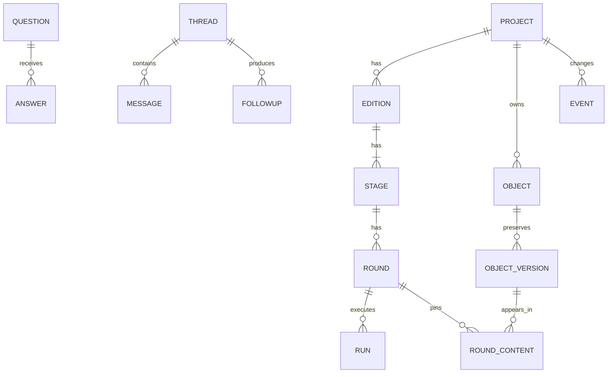

# 1단계 ① DB 설계 — Codex 의견안

- 관련 이슈: **SEL-21**. 작성일: 2026-11-04.
- 상태: 설계 의견. 코드·SQL 마이그레이션·실제 DB·Linear 이슈를 변경하지 않았다.
- 우선순위: 사용자 결정과 확정된 `stage-0.md`를 따른다. 이전 의견·조사 문서의 제안은 설계 입력이며 확정 사항과 구분한다. 0단계 계획이 확정됐다는 사실을 0단계 시험이 모두 통과했다는 뜻으로 해석하지 않는다.

**추천은 관계형 업무 모델 + 추가로 쌓는 버전 + 현재 버전 포인터 + 같은 트랜잭션의 사건 기록이다.** 프로젝트마다 활성 판과 실행 담당을 우선 하나로 제한하되, 사람의 답·첨언은 실행 중에도 받는다. A·B는 같은 테이블을 쓰고 실행기·모델·접속 경로만 기록으로 구분한다. 로컬과 웹은 같은 SQL 스키마를 사용하며, 실행 중 DB 파일의 양방향 동기화는 별도 문제로 다룬다.

근거: [stage-0.md:10–14, 36–48](../stage-0.md#L10-L48), [00-brief.md:16–31, 35–39](../00-brief.md#L16-L39). 아래 표의 열 이름·상태 값은 이 의견안의 제안이다.

## 1. 생각할 주제 목록

| 번호 | 주제 | 핵심 질문 |
|---|---|---|
| 1 | 소유 경계·ID·관계 | 판·단계·라운드·실행을 무엇으로 식별하고 연결할까? |
| 2 | 현재 값·내용 버전·rev·사건 번호 | 덮어쓰지 않고 현재 화면도 빠르게 읽으려면? |
| 3 | 판·라운드 확정·승인·reopen | 어느 버전을 승인했고 뒤 단계가 왜 오래됐는가? |
| 4 | 질문·답·질문별 의견 | 원문·수정·중요도·기본값·당시 답의 의미를 어떻게 보존할까? |
| 5 | 가정·결정·반영 내역 | 사용자 의견→채택 판단→실제 변경을 어떻게 추적할까? |
| 6 | 첨언·위치·대화·후속 결과 | 글이 바뀌어도 첨언과 후속 작업이 남는가? |
| 7 | 출처·각주·재사용 | 같은 URL의 서로 다른 자료·확인 시점을 어떻게 구분할까? |
| 8 | 사람·에이전트·대리 작성·권한 | 브라우저 에이전트가 사람 권한을 썼다고 사람 승인인가? |
| 9 | run·lease·rev·멱등성 | 재시도·인계·늦은 결과·사람 답의 동시 도착을 어떻게 처리할까? |
| 10 | 프로젝트별 자료 전송 정책 | OpenCode Go 전송 끄기가 실제 어느 경로를 막는가? |
| 11 | SQLite·D1·파일 저장소 | 같은 설계를 유지하면서 다른 실행 제약을 어떻게 처리할까? |
| 12 | 기존 자료 이전·되돌리기·여러 컴퓨터 | 원본 보존과 새 작업의 복구를 어떻게 보장할까? |
| 13 | 검색·인덱스·보관·동기화 | 큰 프로젝트·변경 로그·과거 기록을 어디까지 읽을까? |
| 14 | 구현 경계·합격 기준·이슈 예산 | 2단계에서 무엇까지 만들고 PR을 몇 개로 묶을까? |

## 2. 주제마다 정할 것·선택지·판단 기준·추천

### 2.1 소유 경계·ID·관계

- **정할 것:** 프로젝트 아래 판, 판 아래 여섯 단계, 단계 아래 라운드를 별도 식별자로 둔다. 실행(run)은 라운드와 분리한다. 단계 시작 질문은 아직 R1이 없을 수 있다.
- **선택지:** ① `project.json` 전체를 JSON 한 행에 저장 ② 관계·상태는 열과 FK, 작은 복합 값은 JSON ③ 모든 값을 범용 속성 표로 분해.
- **판단 기준:** 부모 범위 위반을 막는가, 기존 항목 번호를 보존하는가, 질문·이력 조회가 쉬운가, 새 기능마다 전체 JSON을 읽고 쓰지 않는가.
- **추천·이유:** ②. 내부 키는 PES가 생성하는 UUID를 TEXT로 저장한다. 화면 번호는 프로젝트별 `Q-12`, `D-3`처럼 별도로 부여하고 재사용하지 않는다. slug·폴더명·공급자 세션 ID는 PK로 쓰지 않는다. 내용 객체의 공통 식별·버전 등록부는 두되 실제 필드는 종류별 표에 둔다. 이 방식은 첨언·반영 내역의 연결 대상을 FK로 확인하면서 모든 내용을 범용 JSON에 숨기는 문제를 줄인다.
- **근거:** [00-brief.md:16, 19–31](../00-brief.md#L16-L31), [stage-0-opencode.md:880–899](stage-0-opencode.md#L880-L899), [notion-linear.md:155, 164](../research/notion-linear.md#L155-L164). 현행 단계별 항목 숫자는 `scripts/pes.py:315–330`, 시작 질문의 `round: 0`은 `questions/plan.json:1–6`.

### 2.2 현재 값·내용 버전·rev·사건 번호

- **정할 것:** 무엇이 불변인지, 어떤 포인터·상태를 갱신할지, 버전과 충돌 검사와 변경 커서를 구분한다.
- **선택지:** ① 현재 행만 갱신 ② 현재 포인터 + 불변 버전 + 사건 기록 ③ 모든 상태를 사건 로그에서 매번 재생.
- **판단 기준:** 과거 보고서·답·승인을 정확히 재현하는가, 읽기와 이전이 복잡해지지 않는가, 로그 누락 때문에 내용 이력이 없어지지 않는가.
- **추천·이유:** ②. `version_no`는 한 내용 객체의 보존 버전 번호, `rev`는 수정 가능한 집합의 충돌 검사 정수, `event_seq`는 DB의 커밋된 변경 순서다. 서로 대신하지 않는다. 되돌리기도 옛 버전을 복사한 **새 버전**을 만들고 복구 출처를 남긴다. 제목·중요도·상태 등 의미 있는 수정도 해당 객체 버전에 포함한다. 현재 포인터·작업 상태·lease 갱신까지 불변 행으로만 표현할 필요는 없지만 그 변화는 사건으로 남긴다.
- **근거:** [00-brief.md:31](../00-brief.md#L31), [notion-linear.md:155–157](../research/notion-linear.md#L155-L157). 현행 덮어쓰기 위치는 `scripts/pes.py:147–158, 400–408, 830–842, 999–1003`이며, 이를 새 DB의 보존 방식으로 그대로 옮기지 않는다.

### 2.3 판·라운드 확정·승인·reopen

- **정할 것:** 판의 시작 기준, 라운드 닫힘과 단계 승인 차이, 승인 대상 버전, 재개방의 영향 범위.
- **선택지:** ① 판마다 프로젝트 전체 복제 ② 이전 판 스냅샷에서 필요한 버전만 선택해 새 판 생성 ③ 판 없이 라운드 번호만 계속 증가.
- **판단 기준:** 이전 판을 고정하면서 일부만 재사용 가능한가, 승인된 글과 인쇄물이 일치하는가, reopen이 과거 기록을 지우지 않는가.
- **추천·이유:** ②. 새 판은 새 단계·라운드·항목 ID를 갖고, 가져온 항목은 원본의 정확한 버전에 `derived_from`으로 연결한다. 이전 판의 현재 포인터를 새 판이 공유하지 않는다. 초기에는 활성 판 하나를 권한다. reopen은 같은 판·단계를 다시 활성화하고 새 라운드를 만든다. 뒤 단계에는 오래됨의 원인 사건을 남기고, 기존 승인 기록은 보존하되 현재 유효성은 해제한다. publish를 다시 열면 판 완료도 해제한다.
- **근거:** [00-brief.md:8, 16](../00-brief.md#L8-L16), 현행 전이는 [scripts/pes.py:442–512](../../../scripts/pes.py#L442-L512). 완료 오처리를 0단계에서 고치기로 한 결정은 [stage-0.md:24](../stage-0.md#L24).

### 2.4 질문·답·질문별 의견

- **정할 것:** 질문 작성자·대상·원문·수정 문구·상태·중요도·기본값, 답이 참조할 질문 버전, 추가 의견과 대화의 구조.
- **선택지:** ① 질문 JSON과 answers 딕셔너리 유지 ② 질문의 정체성·버전·답·대화를 분리 ③ 모든 것을 댓글로 처리.
- **판단 기준:** 고친 질문에 예전 답이 새 답처럼 보이지 않는가, 선택지·조건부 표시·`__other`를 보존하는가, 사람→AI 질문도 같은 구조로 가능한가.
- **추천·이유:** ②. 질문 원문은 최초 버전으로 보존하고 수정할 때마다 새 버전을 만든다. 답은 **당시 질문 버전**을 가리킨다. 선택지의 안정된 값·라벨·순서, 추천 표시와 실제 기본값을 분리한다. 기본값은 응답이 아니며 사용자 제출이 있어야 답이다. 문구·선택지·기본값 변경 후 옛 답은 보존하되 재확인 필요로 판정한다. 질문 의견은 답이 없어도 쓸 수 있고 여러 번 오갈 수 있으므로 스레드·메시지로 둔다.
- **근거:** [00-brief.md:19–26](../00-brief.md#L19-L26), [templates/_questions.html:33–47, 66–93](../../../templates/_questions.html#L33-L93), [questions/plan.json:178–196](../../../questions/plan.json#L178-L196), [stage-0-opencode.md:891–897](stage-0-opencode.md#L891-L897).

### 2.5 가정·결정·반영 내역

- **정할 것:** AI 가정과 사람이 채택한 결정의 차이, 적용 범위·취소·대체·근거, 사용자 의견이 실제 무엇을 바꿨는지.
- **선택지:** ① 요약 문자열만 저장 ② 독립 객체와 버전·근거 연결 ③ 질문 답에서 매번 추론.
- **판단 기준:** 최신 결정 목록을 만들 수 있는가, 기각·보류도 보이는가, 반영했다고 쓴 설명이 실제 변경 버전을 가리키는가.
- **추천·이유:** ②. 가정에는 제안자와 맞음/틀림/수정 판단을 분리하고, 결정에는 초안/채택/대체/철회와 채택자를 둔다. 기본 범위는 판, 계속 적용할 결정만 명시적으로 프로젝트 범위로 올린다. 반영 내역은 원인 답·의견의 버전→판단·사유→변경 버전 또는 후속 작업으로 연결한다. 거절·보류도 기록하며, `applied`에는 결과 버전이나 적용된 작업 기록이 반드시 있어야 한다.
- **근거:** [00-brief.md:24–29](../00-brief.md#L24-L29), [notion-linear.md:129–137, 159](../research/notion-linear.md#L129-L159). 현행 `changes`는 라운드 시작 때 비워지고 이력에는 요지만 남는다(`scripts/pes.py:294–302`).

### 2.6 첨언·위치·대화·후속 결과

- **정할 것:** 어느 글 버전의 어느 부분인지, 재탐색 방법, 스레드 해결과 후속 실행의 차이.
- **선택지:** ① 글자 오프셋만 ② 인용문·앞뒤 문맥·원본 버전 + 보조 위치 ③ 처음부터 협업 편집용 CRDT.
- **판단 기준:** 글 앞에 문단을 추가해도 찾아지는가, 같은 인용문이 여러 번 나올 때 오판하지 않는가, 후속 작업이 실제 끝났는지 알 수 있는가.
- **추천·이유:** ②. 원래 앵커는 불변으로 두고 새 글 버전에서 찾은 위치는 별도 판정 행에 추가한다. 정확히 못 찾으면 ambiguous/lost로 표시하며 자동으로 아무 문장에 붙이지 않는다. 해결된 답글·요약과 후속 결과를 별도로 둔다. 한 대화가 글 수정과 다음 라운드 작업을 함께 낳을 수 있으므로 후속 결과는 일대다다. reopen 제안은 사람이 승인해야 적용한다.
- **근거:** [00-brief.md:21, 31](../00-brief.md#L21-L31), [notion-linear.md:96–100, 129–131, 158–159](../research/notion-linear.md#L96-L159), [webmcp.md:24, 35–37](../research/webmcp.md#L24-L37).

### 2.7 출처·각주·재사용

- **정할 것:** 자료의 정체성과 확인 시점, 원고의 출처 순서, 재사용 근거가 따라갈 버전.
- **선택지:** ① URL을 전역 유일키로 사용 ② 프로젝트별 출처 + 불변 확인 버전 + 인용 연결 ③ 원고마다 출처 배열 복제.
- **판단 기준:** 같은 URL의 서로 다른 조문·제목·시점이 합쳐지지 않는가, 각주 번호가 바뀌지 않는가, 열어 보지 않은 자료를 확인 완료로 표시하지 않는가.
- **추천·이유:** ②. URL은 검색·중복 후보 탐색에 사용하되 유일성 조건으로 두지 않는다. 원고 버전별 인용 순서를 별도 표로 고정하고 정확한 출처 버전을 참조한다. method·확인자·확인 시각·인용 구절·파일 해시를 남긴다. 판을 바꾸면 확인 기록을 보존하되 현행성 재확인 여부를 별도 판단한다.
- **근거:** [scripts/pes.py:334–344](../../../scripts/pes.py#L334-L344), [scripts/pes.py:878–907](../../../scripts/pes.py#L878-L907), [00-brief.md:31](../00-brief.md#L31). 같은 주소라도 제목이 다르면 각주를 나누는 현행은 `scripts/pes.py:886`.

### 2.8 사람·에이전트·대리 작성·권한

- **정할 것:** 실제 수행자, 권한을 빌려준 사람, 런타임·공급자·모델, 접속 경로를 구분한다.
- **선택지:** ① user_id만 저장 ② 사용자와 actor를 나누고 실행·채널을 추가 ③ A/B마다 작성자 표를 별도 생성.
- **판단 기준:** 브라우저 에이전트를 사람으로 오인하지 않는가, 같은 사람이 Claude Code와 앱을 써도 연결 가능한가, 사용자를 삭제·비활성화해도 과거 귀속이 남는가.
- **추천·이유:** ②. actor 종류는 human/agent_internal/agent_external/browser_agent와 system/legacy_unknown을 둔다. 대리 작성은 `on_behalf_of_user_id`로 표시하되 actor 종류를 human으로 바꾸지 않는다. 승인·reopen·판 시작은 사람이 직접 수행한 요청만 허용하고, WebMCP 노출 여부는 API 동작 정책으로 관리한다. DB에도 실제 actor·채널·권한 주체를 남겨 우회·오귀속을 검출한다.
- **근거:** [stage-0.md:47–48, 98](../stage-0.md#L47-L98), [notion-linear.md:136, 155](../research/notion-linear.md#L136-L155), [webmcp.md:9, 17–24, 35–37](../research/webmcp.md#L9-L37).

### 2.9 run·lease·rev·멱등성

- **정할 것:** 실행과 라운드의 관계, 담당 인계·만료·재시도, 충돌 검사 단위, 결과와 사건 기록의 원자성.
- **선택지:** ① 현재 파일 잠금 유지 ② 프로젝트별 lease + 집합별 rev + 제출 키 ③ 처음부터 항목별 병렬 lease.
- **판단 기준:** 이전 실행의 늦은 결과를 막는가, 사람이 답했다고 작업 전체가 불필요하게 충돌하지 않는가, 재전송이 새 버전을 또 만들지 않는가.
- **추천·이유:** ②. 프로젝트별 활성 실행 담당 하나로 시작한다. lease에는 증가만 하는 fence를 두어 만료 후 옛 실행의 제출을 거부한다. `objects.rev` 등 대상 집합의 rev와 `projects.control_rev`를 함께 검사한다. 사람의 일반 답·첨언은 control_rev를 올리지 않고 자신의 대상을 변경하므로 실행 중에도 받을 수 있다. 승인·reopen·전송 정책 변경은 제어 리비전을 바꿔 실행이 맥락을 재확인하게 한다. 재시도 키는 요청 해시와 함께 보관한다.
- **근거:** [stage-0.md:14, 42, 46–48](../stage-0.md#L14-L48), [stage-0-opencode.md:889–899](stage-0-opencode.md#L889-L899). 현행 파일 잠금은 `scripts/pes.py:117–158`, 답 저장과 로그 추가는 별개(`scripts/serve.py:149–151`).

### 2.10 프로젝트별 OpenCode Go 전송 정책

- **정할 것:** 설정 기본값·적용 범위·변경 권한, 실행 중 끄기, 과거 전송 이력.
- **선택지:** ① UI에서 A 시작 버튼만 숨김 ② PES의 모든 Go 자료 반출 경로에 프로젝트 정책 적용 ③ 모든 외부 AI 사용을 일괄 금지.
- **판단 기준:** 사용자 결정 7-1을 정확히 지키는가, 요약·첨부·재시도로 우회되지 않는가, B까지 의도치 않게 막지 않는가.
- **추천·이유:** ②. 새 프로젝트의 명시적 초기값은 허용으로 두되 전송은 사용자가 A 실행을 시작한 뒤에 한다. 설정 누락·손상·출처 프로젝트 불명은 거부한다. 설정과 변경 이력·반출 명세를 보존하고, 체크 시점은 실행 생성뿐 아니라 맥락·파일 제공과 실제 요청 직전까지 포함한다. 이미 외부에 전달된 자료를 되가져오는 기능으로 설명하지 않는다. 상세는 6절.
- **근거:** **확정 사용자 결정** [stage-0.md:85–89](../stage-0.md#L85-L89). 허용/차단 경계와 초기값의 구체적 동작은 이번 추천이다.

### 2.11 SQLite·D1·파일 저장소

- **정할 것:** 공통 SQL 범위, 트랜잭션 어댑터, 본문·파일 크기, DB와 파일의 일관성.
- **선택지:** ① SQLite와 D1에 서로 다른 모델 ② 같은 SQL 스키마·업무 명령, 저장소 접근만 어댑터 ③ 처음부터 별도 서버 DB 사용.
- **판단 기준:** 로컬·웹 전환 때 자료를 다시 해석하지 않아도 되는가, D1에서 원자적으로 검사·저장이 가능한가, 큰 자료가 DB 제한을 넘지 않는가.
- **추천·이유:** ②. TEXT/INTEGER와 FK·UNIQUE·CHECK 중심으로 설계한다. 로컬은 짧은 SQLite 트랜잭션, D1은 검증 조건을 포함한 원자적 batch로 같은 의미를 구현한다. 파일은 로컬 파일 저장소/R2의 불변 객체이고 DB에는 해시·크기·MIME·저장 키만 둔다. D1과 R2를 하나의 분산 트랜잭션으로 취급하지 않는다. 상세는 4절.
- **근거:** [00-brief.md:31, 50](../00-brief.md#L31-L50), 공식 [D1 batch와 Sessions](https://developers.cloudflare.com/d1/worker-api/d1-database/), [D1 외래키](https://developers.cloudflare.com/d1/sql-api/foreign-keys/), [D1 제한](https://developers.cloudflare.com/d1/platform/limits/). 공식 문서는 2026-11-04 확인했다.

### 2.12 기존 자료 이전·되돌리기·여러 컴퓨터

- **정할 것:** 사본·백업·읽기 전용 병행 기간, 옛 필드의 매핑, 새 DB 사용 후의 되돌리기, OneDrive 사용 방식.
- **선택지:** ① 원본을 제자리 변환 ② 사본을 새 DB로 검증 이전하고 프로젝트별로 전환 ③ JSON과 DB에 양방향 동시 쓰기.
- **판단 기준:** 실패 시 원본이 그대로 있는가, 새 작업도 백업 가능한가, 사라진 과거를 만들어 내지 않는가, 두 원본이 생기지 않는가.
- **추천·이유:** ②. JSON은 전환 전 원본·전환 뒤 읽기 전용 보존본으로 둔다. 양방향 쓰기는 하지 않는다. 이전 당시 보존되지 않은 작성자·시각·질문 버전은 unknown으로 기록한다. OneDrive에는 정지 상태의 백업 묶음을 전달하는 방식을 우선 추천한다. 실행 중 SQLite 파일 공유나 로컬·D1 양방향 동기화는 이 설계에 포함하지 않는다.
- **근거:** [stage-0.md:28–29, 92](../stage-0.md#L28-L92), 현행 보완 읽기는 [scripts/pes.py:96–114](../../../scripts/pes.py#L96-L114), 기존 폴더 구성은 `README.md:548–564`. SQLite WAL은 같은 호스트의 프로세스 사이에서 쓰는 방식이다([공식 WAL 문서](https://sqlite.org/wal.html)).

### 2.13 검색·인덱스·보관·동기화

- **정할 것:** 화면별 필요한 범위, 사건 로그 커서, 버전·파일 보관·삭제, 외부 내보내기 경계.
- **선택지:** ① 전체 프로젝트를 매번 받음 ② 현재 목록·필요한 상세·변경분을 나눔 ③ Linear 수준의 오프라인 동기화 엔진부터 구현.
- **판단 기준:** 2MB급 기존 자료에서도 필요한 부분만 읽는가, 숨김·복구가 이력과 맞는가, 다른 프로젝트·권한의 사건이 새지 않는가.
- **추천·이유:** ②. 프로젝트·판·단계·상태·버전·사건 번호에 인덱스를 둔다. 본문 검색용 FTS는 핵심 FK·버전 설계의 필수 조건으로 삼지 않는다. 기본 삭제는 archive와 새 사건이며, 참조 중인 버전·파일은 자동 GC하지 않는다. Linear·Notion은 선택적 내보내기 대상이고 PES가 원본이다. 모델 토큰 스트림·키·전체 프롬프트를 업무 사건 로그에 복제하지 않는다.
- **근거:** [stage-0.md:23, 97](../stage-0.md#L23-L97), [notion-linear.md:64–70, 149–157](../research/notion-linear.md#L64-L157).

### 2.14 구현 경계·합격 기준·이슈 예산

- **정할 것:** 전체 스키마 청사진 중 2단계 구현 범위, 검토 가능한 PR 크기, 완료 증거.
- **선택지:** ① 표마다 이슈 ② 사용자 흐름을 완성하는 PR 묶음 ③ DB·API·UI 전체를 한 PR.
- **판단 기준:** PR별 독립 검증·되돌리기가 가능한가, 총 260개 이슈 한도를 과소비하지 않는가, 뒤 단계 기능을 앞당기지 않는가.
- **추천·이유:** ②. 2단계는 기존 동작을 새 DB+API로 대체하는 데 집중한다. 첨언·가정·결정의 세부 스키마는 설계하되 본격 소통 UI는 3단계, 판 시작·비교 UI는 4단계, 운영 D1·R2와 로그인은 5단계다. 2단계는 **12개 PR/이슈**를 기준으로 예상하며 세부안과 합격 기준은 8절에 적는다.
- **근거:** [00-brief.md:43–51](../00-brief.md#L43-L51), [stage-0.md:51–67](../stage-0.md#L51-L67). 이슈 한도와 PR 단위 원칙은 이번 사용자 지시다.

## 3. 테이블 초안과 관계

### 3.1 표기·공통 규칙

- `PK`는 기본키, `FK →`는 참조, `UQ`는 유일성 조건이다. `?`는 NULL 허용이다. 생략한 생성 시각·작성자·트랜잭션은 공통 열로 적용한다.
- 시각은 UTC epoch milliseconds INTEGER, 표시는 사용자 시간대로 한다. 기존 시각은 원문과 해석 근거도 보존한다. 상태는 TEXT+CHECK, 참/거짓은 INTEGER의 0/1, 작은 배열·조건·통계는 형식을 검사한 TEXT JSON으로 저장한다.
- 프로젝트 자료 표에는 `project_id`를 둔다. `(project_id, id)` 유일키와 복합 FK로 **다른 프로젝트의 판·버전·질문·파일을 끼워 넣지 못하게** 한다. 부모·자식의 판·단계 일치도 검증한다. 프로젝트 범위 객체의 `edition_id=NULL`만 명시적으로 허용한다.
- 불변 내용 버전은 UPDATE·DELETE API를 제공하지 않는다. 현재 포인터·rev·운영 상태는 PES의 검증된 쓰기 경로로만 바꾼다. FK 기본 삭제 동작은 RESTRICT이며 연구 기록 전체에 CASCADE를 걸지 않는다.
- ID는 서버에서 생성하고 화면 번호는 `counters`로 트랜잭션 안에서 배정한다. `MAX(id)+1`·시각 기반 파일명을 새 키 생성 규칙으로 쓰지 않는다.

그림은 주요 관계만 표시한다. `QUESTION/ANSWER/THREAD/MESSAGE/FOLLOWUP`는 `OBJECT`의 종류별 표다.

### 3.2 사람·에이전트·프로젝트의 기본 표

| 표 | 주요 열·키·관계 | 이유 |
|---|---|---|
| `users` | `id PK, display_name, auth_subject? UQ, disabled_at?` | 사람의 권한 주체. 로컬 한 명 이용에도 고정 사용자를 만든다. 인증정보 본체는 넣지 않음 |
| `actors` | `id PK, kind, user_id? FK, runtime?, provider?, display_name, disabled_at?` | 실제 작성자. human은 user 필수, AI는 runtime/provider를 가지며 확정 모델은 run에 기록. system/legacy_unknown도 허용 |
| `project_members` | `(project_id,user_id) PK/FK, role(owner/editor/reader)` | 향후 여러 사람을 위해 소유자만으로 접근을 판단하지 않음. 소유자가 없어지는 변경은 금지 |
| `agent_grants`［5단계］ | `id PK, project_id FK, actor_id FK, scopes_json, credential_ref, expires_at?, revoked_at?` | 에이전트 접속 범위. 키 본체는 설정·비밀정보 관리 쪽에 둔다. 해시 등을 통한 인증 방식은 인증 설계에서 정함 |
| `projects` | `id PK, slug UQ, topic, owner_user_id FK, active_edition_id?, status, control_rev, current_policy_id? FK` | 프로젝트 제어점. active_edition은 같은 프로젝트의 판만 참조. 프로젝트와 판에 complete를 중복 관리하지 않음. 정책 NULL은 생성 중에만 허용하며 활성 프로젝트에는 정책 필수 |
| `project_policy_versions` | `id PK, project_id FK, policy_rev, allow_opencode_go_data CHECK(0/1), changed_by FK actors, reason, tx_id FK, UQ(project_id,policy_rev)` | 전송 허용의 불변 이력. 현행값은 projects의 포인터에서 읽음. 일반 settings JSON에 묻어 두지 않음 |
| `counters` | `(project_id, namespace) PK, next_no` | Q/C/D/A 등의 표시 번호와 판 번호. 이력을 지워도 재사용하지 않음 |

모든 생성·변경에는 실제 수행한 `actor_id`, 필요할 때 `on_behalf_of_user_id`, `via=web/cli/http/mcp/webmcp/import`를 `mutation_commits`에 기록한다. 사람의 로그인 권한을 쓰는 browser_agent도 사람의 직접 승인이 되지는 않는다.

actor·via·프로젝트 권한은 인증된 세션/어댑터에서 PES가 확정하며 클라이언트의 자기 신고만 믿지 않는다. 새 사람 승인에서는 actor.kind, user 연결, 직접 확인한 동작과 권한을 함께 검증한다. 프로젝트 최초 생성의 정책 포인터 등 순환 참조는 같은 트랜잭션 안에서 임시 NULL→부모/자식 생성→포인터 확정 순서로 처리하고, 활성화된 행에 필수 참조가 없는 상태는 허용하지 않는다.

근거: `stage-0.md:87–89`, `research/notion-linear.md:136, 155, 164`, `research/webmcp.md:35–37`.

### 3.3 프로젝트→판→단계→라운드와 승인

| 표 | 주요 열·키·관계 | 이유 |
|---|---|---|
| `editions` | `id PK, project_id FK, edition_no, parent_edition_id?, base_snapshot_id?, status(draft/active/completed/archived), current_stage_id?, settings_json, rev, UQ(project_id,edition_no)` | 판마다 단계·설정을 분리. 부모판과 기준 스냅샷을 고정하고 새 판의 변경이 원판에 번지지 않게 함 |
| `stages` | `id PK, project_id, edition_id FK, key(plan/research/analyze/write/verify/publish), ordinal, status(pending/asking/active/approved), current_round_id?, approved_snapshot_id?, stale_since_event_seq?, settings_json, rev, UQ(edition_id,key)` | 같은 단계명도 판마다 다른 실체. stale은 승인 기록을 지우는 대신 영향 원인을 가리킴 |
| `rounds` | `id PK, project_id, stage_id FK, round_no, state(open/sealed), base_snapshot_id?, sealed_snapshot_id?, opened_by FK, opened_at, sealed_at?, rev, UQ(stage_id,round_no)` | 한 라운드에 여러 run 가능. 시작 폼은 `round_id=NULL`로 두며 가상의 완료 R0을 만들지 않음 |
| `round_contents` | `(round_id,object_id) PK/FK, version_id FK, position, role(result/question/answer/review/...)` | 라운드에서 보였던 **정확한 버전 목록**. 바뀌지 않은 항목도 이전 버전을 고정해 전체 내용을 재현 |
| `snapshots` | `id PK, project_id, edition_id FK, stage_id?, round_id?, scope, manifest_blob_id FK, through_event_seq, control_rev, created_by, content_hash` | 라운드·단계 승인·판 기준의 고정 manifest. 사건 커서와 포함 버전을 함께 보존 |
| `approvals` | `id PK, project_id, stage_id FK, snapshot_id FK, actor_id FK, human_user_id? FK, origin(new/legacy), assurance(verified/legacy_unverified), tx_id FK, note?, created_at` | 무엇을 누가 승인했는지 불변 기록. 새 승인은 확인된 human_user 필수, 작성자를 모르는 옛 승인은 legacy로 구분. reopen은 현재 승인 포인터만 해제 |

열거된 stage가 한 판에 정확히 여섯 개이며 순서가 맞는지는 판 생성 명령의 원자적 검사로 보장한다. 승인 시점에는 최신 snapshot과 미처리 답·남은 작업·검토 결과를 함께 검사한다. 사용자가 남은 일을 넘기고 승인하면 해당 작업의 이월 관계도 같은 트랜잭션에서 만든다. 라운드 봉인 이후의 수정·답은 기록을 바꾸지 않고 다음 작업 대상으로 쌓는다.

활성 판 하나·열린 라운드 하나라는 초기 규칙은 부분 UNIQUE 인덱스와 명령 검증으로 함께 제한한다. 가령 활성 판의 project_id, 열린 라운드의 stage_id에는 각각 중복을 허용하지 않는다. 앞 단계 어느 곳을 reopen하더라도 판의 completed 상태는 active로 되돌리고 뒤 단계의 기존 승인은 현재 유효 승인으로 취급하지 않는다. 단계 승인과 판 완료를 다른 사실로 기록한다.

설정 변경은 해당 집합의 rev와 사건의 이전/이후 값을 함께 기록하고 승인·라운드 스냅샷에 당시 설정을 넣는다. 모든 환경 설정을 내용 버전 표로 옮길 필요는 없지만 어떤 설정으로 수행했는지는 복원할 수 있어야 한다.

근거: `00-brief.md:8,16`, `scripts/pes.py:167–170, 290–305, 442–512`, `skills/core/SKILL.md:133–135`.

### 3.4 내용 객체·결과물·버전·파일·출처

| 표 | 주요 열·키·관계 | 이유 |
|---|---|---|
| `objects` | `id PK, project_id FK, edition_id? FK, kind, display_no, current_version_id?, rev, archived_at?, UQ(project_id,kind,display_no)` | 첨언·근거·반영 내역이 참조할 공통 정체성. 연구 내용은 이 표의 JSON에 넣지 않음 |
| `object_versions` | `id PK, project_id, object_id FK, version_no, based_on_version_id?, created_in_round_id? FK, actor_id FK, run_id? FK, tx_id FK, content_hash, created_at, UQ(object_id,version_no), UQ(object_id,id)` | 모든 내용의 불변 버전 등록부. 사람 편집도 당시 라운드를 기록. 객체의 현재 포인터는 `(object_id,current_version_id)` 복합 FK로 자기 버전만 가리킴 |
| `artifacts` | `object_id PK/FK, stage_id? FK, artifact_kind(rq/chapter/topic/issue/table/section/claim/report/review/note/...), origin_version_id? FK` | 현행 item과 문서·보고서를 포괄. 보고서는 조사항목과 kind가 다르고 별도 정체성을 가짐 |
| `artifact_versions` | `version_id PK/FK, object_id FK, title, question?, summary, body_md?, body_blob_id?, status, confidence?, stats_json, conflicts_json, verify_json, metadata_json` | 본문·요약·상태·통계·검증을 그때의 묶음으로 보존. 본문이 있으면 DB/R2 중 정확히 한 표현을 원본으로 선택하고 해시를 맞춤 |
| `artifact_components` | `(parent_version_id,position) PK, child_version_id FK, section_label?` | 최종/단계 보고서가 사용한 장·절의 정확한 버전과 순서를 고정 |
| `version_relations` | `(from_version_id,to_version_id,kind) PK/FK, position?` | `derived_from/supports/supersedes/reuses/related` 등 근거 연결. 새로운 본문 버전이 만들어져도 옛 연결이 사라지지 않음 |
| `sources` | `object_id PK/FK, source_kind(web/file/stat/law/...), canonical_locator?` | 자료 정체성. locator/URL은 UQ가 아니며 전역 합치기 금지 |
| `source_versions` | `version_id PK/FK, object_id FK, title, url?, locator_json, published_at_raw?, retrieved_at?, method, verification_state, verified_by_actor_id?, evidence_blob_id?, quote?` | 실제 확인한 자료와 시점을 고정. 날짜·조문·통계표 조건·미확인 이유를 보존 |
| `citations` | `(artifact_version_id,citation_no) PK, source_version_id FK, quote?, locator_json` | 해당 원고 버전의 각주 순서 보존. 여러 각주가 같은 출처 버전을 참조할 수 있음 |
| `blobs` | `id PK, project_id FK, storage_key UQ, sha256, byte_size, media_type, original_name?, state(staging/ready/quarantined), created_by, created_at` | 로컬/R2 공통 파일 메타데이터. 키는 불변·비공개이며 실제 경로나 서명 URL을 영구 식별자로 쓰지 않음 |
| `version_files` | `(version_id,blob_id,role) PK/FK, position` | 이미지·표 원자료·내보낸 문서·산출 파일을 정확한 내용 버전에 연결 |

`object_versions`에는 제목·본문을 통째로 중복 저장하지 않고, 종류별 `*_versions`에 실제 열을 둔다. `kind`와 일치하는 세부 버전이 반드시 하나 있어야 한다. 같은 프로젝트·객체·kind인지 FK/제약으로 최대한 제한하고, 세부표의 완전성·상태 전이는 PES 명령 검증으로 확인한다. 문자열 `target_kind + target_id`만 저장해 존재하지 않는 대상을 허용하는 모델은 피한다.

모든 항목을 판이 달라도 공유하는 전역 가변 객체로 만들지 않는다. 재사용은 **새 판의 새 artifact + origin_version_id**다. 물리 파일 바이트를 공유하더라도 권한·전송 차단 검사는 프로젝트별로 해야 한다. `library.json`은 연구 데이터이므로 검색 가능한 항목·출처로 옮기고 원본도 보존한다. 큰 첨부 파일과 같은 이유로 library 전체를 R2에만 넣어 버리지는 않는다.

근거: `scripts/pes.py:111–113, 147–158, 173–176, 219–239, 334–357, 470–493, 878–907`, `research/notion-linear.md:155–159`.

### 3.5 질문 원문·수정·답·질문별 의견

| 표 | 주요 열·키·관계 | 이유 |
|---|---|---|
| `question_sets` | `id PK, project_id, stage_id FK, round_id? FK, purpose(stage_start/review/resume), form_key?, version_no, previous_set_id?, published_at` | 사람이 실제 본 폼의 버전. 질문 추가·제외·순서 변경도 새 set으로 보존 |
| `question_set_members` | `(set_id,question_id) PK/FK, question_version_id FK, position` | 폼이 가리킨 질문 버전·순서 고정. question_id 일치 검사 |
| `questions` | `object_id PK/FK, asked_by_actor_id FK, intended_actor_id?, direction(agent_to_human/human_to_agent/...), origin(bank/review/manual/import), bank_key?, original_version_id FK` | 누가 누구에게 왜 물었는지. 원문은 original_version의 text이며 현재 문구와 구분 |
| `question_versions` | `version_id PK/FK, object_id FK, text, type, state(draft/open/deferred/merged/withdrawn/closed), importance(high/normal/low), required, allow_comment_as_answer, default_value_json, options_json, show_if_json, help?, defer_until?, merged_into_question_id?` | 고친 문구·선택지·상태·중요도·기본값을 함께 보존. 선택지는 안정된 value·label·recommended·position 포함 |
| `submissions` | `id PK, project_id, actor_id FK, drafted_by_actor_id? FK, set_id? FK, received_at, via, raw_blob_id?, tx_id FK, legacy_feedback_name?` | 한 번 보낸 폼·자유 피드백의 봉투. 초안을 쓴 에이전트와 실제 제출자를 구분. 구조화 답과 원문을 모두 남기되 동일 제출 중복 방지 |
| `answers` | `object_id PK/FK, question_id FK, respondent_actor_id FK, submission_id FK` | 답의 정체성. 향후 여러 사람 응답을 막는 question_id 단독 UQ는 두지 않음 |
| `answer_versions` | `version_id PK/FK, object_id FK, question_version_id FK, value_json, state(submitted/skipped/withdrawn), used_default(0/1/unknown), supersedes_version_id?` | 답 수정도 추가 버전. 빈 값·건너뜀·아직 답하지 않음을 구분. 질문 조건이 맞지 않아 숨겨진 답을 필수 누락으로 보지 않음 |
| `answer_drafts`［3단계］ | `(question_version_id,actor_id) PK/FK, value_json, updated_at, draft_rev` | 브라우저 에이전트가 채우는 초안. 제출 답·승인과 별도이며 자동 학습/실행 근거로 쓰지 않음 |
| 질문별 의견 | `threads.target_object_id → questions/answers`, `context_kind=question_comment`, `messages.submission_id?` | 별도 의견 문자열 하나로 제한하지 않고 답 없이도 의견·재질문·여러 답글을 허용 |

`recommended`는 AI 추천 설명, `default_value_json`은 실제로 미리 채우는 값이다. 선택형 기본값은 options의 value를 참조하고 필수·타입과 맞아야 한다. 조건부 질문은 같은 set의 안정된 question_id를 참조하고 순환·없는 질문을 거부한다. 표시 상태는 당시 set과 답으로 계산한다. 질문 상태와 「현행 질문 버전에 유효한 답이 있는가」는 분리하며, 후자는 파생값으로 계산한다.

질문 문구를 고쳤을 때 옛 답을 새 버전에 자동 승계하지 않는 것을 기본으로 한다. 오탈자처럼 같은 뜻이라고 사람이 확인하면 새 질문 버전에 답을 재확인했다는 기록을 추가할 수 있다. 질문을 합칠 때 원래 질문·답을 지우지 않고 merged_into로 연결한다.

이전 시 `answers[qid]`는 answer, `answers[qid+'__other']`는 질문 스레드의 메시지로 옮긴다. 선택 없이 `__other`만 있던 입력도 유효한 의견으로 남긴다. 폼 맨 아래 note/text는 제출 전체의 의견이며 임의의 질문에 배정하지 않는다.

현행은 필수 질문도 덧붙임만 있으면 수집한다(`templates/_questions.html:85–88`). 따라서 「필수 답을 의견으로 대신할 수 있는가」를 검증 규칙에 명시해야 한다. 현행 호환 폼은 이를 허용하고, 새 질문에서 더 엄격히 구분하려면 `question_versions.allow_comment_as_answer` 같은 명시적 설정으로 표현한다. 빈 선택값을 사용자가 어떤 선택지에 동의한 것으로 바꾸면 안 된다.

근거: `templates/_questions.html:35–47, 66–93`, `templates/ask.html:96–100`, `scripts/serve.py:126–148`, `questions/plan.json:1–18, 178–196`.

### 3.6 가정·결정·첨언·대화·후속 결과·반영 내역

| 표 | 주요 열·키·관계 | 이유 |
|---|---|---|
| `assumptions` | `object_id PK/FK, proposed_by_actor_id FK, target_object_id? FK` | 가정 정체성. 사람이 바꿔도 AI의 원래 제안 귀속 유지 |
| `assumption_versions` | `version_id PK/FK, object_id, statement, state(proposed/confirmed/rejected/revised), assessment_actor_id?, rationale, replacement_version_id?` | 맞음/틀림/수정 판단과 이유·판단자를 보존 |
| `decisions` | `object_id PK/FK, scope(project/edition), originated_from_version_id? FK` | 적용 범위 명시. 서로 다른 판의 결정을 무심코 한 최신 목록으로 합치지 않음 |
| `decision_versions` | `version_id PK/FK, object_id, statement, state(proposed/adopted/superseded/revoked), decided_by_actor_id?, rationale, effective_at?, supersedes_decision_id?` | 살아 있는 결정 목록과 과거 결정 모두 조회. AI 제안과 사람 채택을 구분 |
| `threads` | `object_id PK/FK, target_object_id FK, target_version_id? FK, context_kind(annotation/question_comment/general), anchor_id? FK` | 첨언·질문별 의견·일반 대화의 공통 스레드. 글 부분 첨언은 정확한 artifact version 필수 |
| `thread_versions` | `version_id PK/FK, object_id, state(open/resolved/archived), resolved_by_message_version_id?, summary, resolved_by_actor_id?, resolved_at?` | 어느 답글이 결론인지와 해결/재개 이력. 해결 상태가 후속 작업 완료를 의미하지 않음 |
| `anchors` | `id PK, project_id, target_version_id FK, exact_quote, prefix_text, suffix_text, text_format_version, block_hint?, start_cp?, end_cp?, created_at` | 작성 당시 인용문+앞뒤 문맥을 불변 보존. 위치는 정규화된 본문의 Unicode code point 기준이며 JS UTF-16 오프셋과 변환 규칙 명시 |
| `anchor_resolutions` | `id PK, anchor_id FK, evaluated_version_id FK, status(exact/moved/ambiguous/lost), start_cp?, end_cp?, method, checked_at, confirmed_by_actor_id?` | 원문 변경 후 위치 판정은 덧붙임. 한 구절이 여러 번 나오면 문맥으로 후보를 좁히고 불확실하면 사람 확인 |
| `messages` | `object_id PK/FK, thread_id FK, reply_to_message_id? FK, submission_id? FK` | 대화 순서와 답글 관계. reply_to는 같은 thread 안이어야 함 |
| `message_versions` | `version_id PK/FK, object_id, body_md, state(published/edited/withdrawn)` | 메시지 편집도 보존. 작성자·대리 사용자·모델은 version→run/tx로 추적 |
| `followups` | `object_id PK/FK, origin_thread_id? FK, origin_message_version_id? FK, origin_version_id? FK` | 대화·답·결정에서 나온 후속 일. 한 thread에 여러 개 가능 |
| `followup_versions` | `version_id PK/FK, object_id, kind(edit_text/next_round_task/reopen_stage/none), state(proposed/accepted/running/applied/deferred/rejected/cancelled), description, target_stage_id?, target_round_id?, base_artifact_version_id?, proposed_artifact_version_id?, confirmed_by_actor_id?, applied_tx_id?` | 세 가지 결과를 구분하고 제안·채택·실제 적용도 분리. next_round_task는 연구 할 일이며 Linear 개발 이슈가 아님 |
| `reflection_entries` | `id PK, project_id, source_version_id FK, target_round_id FK, disposition(applied/partial/rejected/deferred), rationale, result_version_id? FK, followup_id? FK, applied_tx_id?, supersedes_entry_id?, actor_id, tx_id` | 다음 라운드 첫머리의 반영 내역. 정정은 새 행. 적용됐다는 주장에 실제 변경 또는 완료된 후속 조치 연결 필수 |

앵커의 `start_cp/end_cp`는 정규화 본문에서 반열린 구간 `[start,end)`다. `exact_quote`는 당시 보이는 원문도 보존하고, 재탐색 정규화 방식은 `text_format_version`에 묶는다. PDF·표·이미지는 우선 파일 버전+인용문·페이지/셀 힌트를 보존하며, 위치를 안정적으로 계산하지 못하면 문서 단위 첨언으로 표시한다.

후속 적용은 하나의 업무 명령으로 수행한다. 글 수정은 제안 버전이 현재 기반과 맞는지 확인 후 새 artifact version을 채택한다. 다음 라운드 작업은 할 일과 배정 관계를 만든다. reopen은 사람이 직접 확인한 뒤 단계 제어 변경·뒤 단계 stale·사건 기록을 함께 저장한다. thread 해결 버튼만 눌렀다고 이 작업들을 완료 처리하지 않는다.

근거: `00-brief.md:21,24–29,31`, `research/notion-linear.md:129–131,155–159`, `research/webmcp.md:24,35–37`.

### 3.7 실행·lease·rev·사건·전송

| 표 | 주요 열·키·관계 | 이유 |
|---|---|---|
| `runs` | `id PK, project_id, edition_id FK, stage_id? FK, round_id? FK, scope, actor_id FK, mode(A/B), runtime, provider, model, role(worker/reviewer/...), status(queued/running/waiting_human/succeeded/failed/cancelled/interrupted), parent_run_id?, retry_of_run_id?, external_session_ref?, base_control_rev, context_snapshot_id?, workflow_version, started_at?, ended_at?, usage_json?` | 라운드와 실행·재시도를 분리. 시작 폼/판 전체 질의처럼 round가 없는 실행은 범위를 명시. 모델·도구·프롬프트 버전은 실행 당시 값을 기록 |
| `run_targets` | `(run_id,object_id) PK/FK, base_version_id? FK, base_rev` | 담당 항목·당시 기반을 제한. 같은 run이 임의의 다른 항목을 수정하지 못하게 함 |
| `project_leases` | `project_id PK/FK, lease_id UQ, run_id? FK, owner_actor_id?, fence INTEGER, acquired_at?, heartbeat_at?, expires_at?, revoked_at?` | 프로젝트별 실행 담당 하나. 인계마다 fence 증가, 행을 삭제해 번호를 초기화하지 않음. 과거 내역은 events |
| `run_input_receipts` | `(run_id,input_version_id) PK/FK, state(seen/applied/ignored), reason?, applied_tx_id? FK, updated_at` | 답뿐 아니라 질문별 의견·자유 피드백 메시지의 정확한 버전을 처리 대상으로 삼음. 읽음과 반영 완료를 구분하고 run 종료만으로 일괄 완료 처리하지 않음 |
| `mutation_commits` | `id PK, project_id, edition_id?, stage_id?, round_id?, run_id? FK, actor_id FK, on_behalf_of_user_id?, via, client_request_id, request_hash, action, base_control_rev?, lease_id?, fence?, guard_ok CHECK(guard_ok=1), result_json, created_at, UQ(project_id,actor_id,client_request_id)` | 검증된 변경 단위와 당시 작업 범위·재시도 영수증. 동일 키·동일 요청은 원래 결과 반환, 같은 키·다른 요청은 거부 |
| `events` | `event_seq INTEGER PK AUTOINCREMENT, id UQ, project_id FK, run_id? FK, tx_id FK, tx_index, tx_size, type, object_id?, before_rev?, after_rev?, before_version_id?, after_version_id?, payload_json, schema_version, created_at, UQ(tx_id,tx_index)` | 번호 붙은 커밋 변경 로그·증분 읽기. 긴 본문 대신 버전 참조와 작은 상태 차이. 사용자 제출 이벤트는 직접 신뢰하지 않고 PES가 확정 |
| `outbound_dispatches` | `id PK, project_id, run_id FK, provider, policy_version_id FK, manifest_blob_id? FK, payload_hash, state(prepared/authorized/sent/blocked/failed/unknown), authorized_at?, sent_at?, response_ref?, request_key UQ` | 무슨 프로젝트의 어느 버전·파일이 어떤 허용 판단으로 Go에 나갔는지. 요청 시간초과 시 이미 보냈을 수 있어 unknown 구분 |
| `db_meta` | `id PK, schema_version, database_instance_id, cursor_epoch` | 복원·다른 DB로 이동 때 사건 커서를 무효화. 내용 UUID와 DB의 사건 번호를 혼동하지 않게 함 |

`objects.rev`는 해당 객체의 현재 버전·archive 상태 변경 때 증가한다. 단계·라운드·판에는 각자의 rev가 있고, `projects.control_rev`는 활성 판·단계 전이·승인·reopen·전송 정책처럼 실행 맥락을 바꾸는 명령에 증가한다. heartbeat는 내용 rev를 바꾸지 않는다. API의 `rev`는 어떤 집합의 것인지 이름과 응답에서 명시해야 하며 전역 사건 번호로 대신하지 않는다.

lease는 사람의 질문·답·첨언을 막는 잠금이 아니다. 에이전트의 결과 채택 권한을 제한한다. 질문을 기다릴 때 lease를 놓을 수 있지만 run은 waiting_human으로 남는다. 재개 시 새 lease/fence와 최신 맥락을 받고, 옛 토큰으로 온 결과는 받지 않는다. 실제 TTL·heartbeat 간격은 SEL-18·19의 시험 결과와 API 설계에서 정하며 기존 2시간을 그대로 보장값으로 삼지 않는다.

사건 번호는 **한 DB의 커밋된 순서**이며 연속 번호를 보장하지 않는다. 여러 DB 사이의 전역 순서·증명 가능한 변조 방지 로그라고 부르지 않는다. 이벤트 읽기는 프로젝트 권한으로 제한하고 `(database_instance_id,cursor_epoch,last_event_seq)` 커서를 사용한다. 복원·클라우드 이전 때 커서가 바뀌면 현재 스냅샷부터 다시 받는다. 트랜잭션을 나누어 읽을 경우 `tx_index/tx_size`로 완결된 묶음만 화면에 적용한다.

근거: `stage-0.md:14,42,47–48,87–89`, `discussion/stage-0-opencode.md:884–899`, `research/notion-linear.md:156,160–164`, `research/webmcp.md:35–37`.

### 3.8 이전·백업 기록

| 표 | 주요 열·키·관계 | 이유 |
|---|---|---|
| `import_batches` | `id PK, project_id?, source_fingerprint UQ, source_schema, importer_version, source_manifest_blob_id FK, state(staging/validated/activated/failed), report_blob_id?, started_at, activated_at?` | 사본 이전의 재개·중복 방지·검증 증거. 활성화 전에는 일반 목록에서 숨김 |
| `legacy_mappings` | `(import_batch_id,legacy_kind,legacy_scope,legacy_key,content_hash) PK, new_object_id?, new_version_id?, new_row_id?` | 단계별 숫자 ID·질문 키·피드백 파일명을 새 UUID/버전에 대응. 반복 질문 ID와 라운드 차이를 보존 |

알 수 없는 필드·손상 파일·누락 이미지를 삭제하지 않고 원본 manifest와 이전 보고서에 보존한다. 미지원 필드는 `legacy_extra` 자료로 남기되 새 업무 로직의 허용 필드로 자동 승격하지 않는다. 기존 `"pes":1`만으로 정규화 상태나 호환성을 확정하지 않는다.

근거: `stage-0.md:28–29,62`, `scripts/pes.py:96–114,206–212`.

### 3.9 최소 인덱스와 불변식

| 조회·제약 | 인덱스·검사 초안 |
|---|---|
| 프로젝트 현재 화면 | editions `(project_id,status,edition_no)`, stages `(edition_id,ordinal)`, rounds `(stage_id,round_no)` |
| 내용·과거 버전 | objects `(project_id,edition_id,kind,archived_at)`, object_versions `(object_id,version_no)`, round_contents `(round_id,position)` |
| 질문·답·의견 | question_sets `(stage_id,round_id,published_at)`, answers `(question_id,respondent_actor_id)`, threads `(target_object_id)`, messages `(thread_id)` |
| 근거·각주 | citations `(source_version_id)`, version_relations `(to_version_id,kind)`. 원고의 인용 순서는 PK로 고정 |
| 작업·재개 | runs `(project_id,status)`, run_input_receipts `(run_id,state)`, lease의 project PK·lease_id UQ |
| 변경·재시도 | events `(project_id,event_seq)`, mutation의 `(project_id,actor_id,client_request_id)` UQ |
| 파일·이전 | blobs `(project_id,sha256)`, legacy_mappings의 import 범위 키, import_batches source_fingerprint UQ |

자기 객체의 버전만 현재 포인터로 가리키기, 버전과 subtype의 객체·종류 일치, 승인 snapshot의 같은 단계·판 소속, 답의 question_version 소속, reply_to의 같은 thread 소속을 검증한다. 관계·근거 그래프의 순환을 모두 금지하지는 않지만 판의 부모·답글 체인·조건부 질문·보고서 구성은 순환하면 안 된다. 큰 JSON·불필요한 인덱스를 늘리기보다 대표 화면의 쿼리 계획과 2MB급 이전 표본으로 조정한다.

## 4. 로컬 SQLite·Cloudflare D1·R2를 같은 설계로 쓰는 방법

### 4.1 같은 것은 업무 모델·SQL·검사, 다른 것은 접근 어댑터

| 영역 | 공통 약속 | 로컬 SQLite | Cloudflare D1 |
|---|---|---|---|
| 스키마 | 번호 붙은 SQL 마이그레이션과 같은 FK·UNIQUE·CHECK·인덱스 | 로컬 적용 도구 | 같은 파일을 D1 마이그레이션 도구로 적용 |
| 키·JSON·시각 | TEXT UUID, 검증한 JSON TEXT, UTC INTEGER | 같은 형식 | 같은 형식 |
| 쓰기 | 업무 명령→조건 검사→버전·포인터·사건·영수증을 한 번에 | 짧은 `BEGIN IMMEDIATE` 트랜잭션 | 미리 만든 조건 검사와 변경문을 하나의 `batch()`에 넣음 |
| FK | 모두 켠 상태로 검사 | 연결마다 `foreign_keys=ON` | 기본 강제. 비활성화에 의존하지 않음 |
| 읽기 일관성 | 변경 응답의 버전·사건 커서에 못 미치는 결과를 최신으로 표시하지 않음 | 읽기 트랜잭션/같은 연결 | 초기에는 primary 읽기. 복제본 사용 시 Sessions·bookmark로 순서 일관성 유지 |
| 동작 시험 | 같은 합성 fixture·명령·성공/충돌/실패 결과 | 실제 SQLite로 검사 | Wrangler 로컬 D1로 검사, 운영 전 D1 검증 DB에서도 재확인 |
| 큰 파일 | 불변 storage_key·해시·크기·MIME·ready 여부 | PES가 관리하는 파일 저장소 | 비공개 R2 bucket, PES를 통한 권한 검사 |

공통 SQL에는 journal mode·파일 경로·D1 binding 이름을 넣지 않는다. SQLite의 WAL·busy timeout·백업과 D1 Sessions·binding은 각각의 접근 어댑터 설정이다. Python 3.9라는 버전만으로 내장 SQLite의 모든 기능을 가정하지 말고, 실제 사용 함수·제약을 지원하는지 시작 시 확인한다. 핵심 모델은 확장 모듈·가상 테이블·DB별 JSON 전용 타입을 요구하지 않는다.

공식 근거: [D1 마이그레이션](https://developers.cloudflare.com/d1/reference/migrations/), [D1 외래키](https://developers.cloudflare.com/d1/sql-api/foreign-keys/), [D1 batch·Sessions](https://developers.cloudflare.com/d1/worker-api/d1-database/). 로컬 D1 에뮬레이션 통과만으로 운영 D1의 제약·권한·실패 동작까지 검증됐다고 보지 않는다.

### 4.2 D1에서 특히 필요한 원자적 변경 규칙

`batch()`가 원자적이라는 사실만으로 낙관적 충돌 검사가 완성되는 것은 아니다. **조건부 UPDATE가 0행을 바꾼 것은 SQL 오류가 아니다.** 첫 UPDATE가 rev 불일치로 0행이어도 다음 버전·사건 INSERT가 실행되는 구현은 금지한다.

권하는 명령 처리 순서는 다음과 같다.

1. 인증·프로젝트 접근·허용 동작·입력 크기를 확인하고, 실제 payload의 해시를 계산한다. 같은 요청 키의 완료 영수증이 있으면 해시가 같은지 확인한 뒤 원래 결과를 반환한다.
2. 필요한 파일은 먼저 임시 저장·검증해 ready로 만든다. 외부 모델 호출·파일 업로드를 DB 트랜잭션 안에서 기다리지 않는다.
3. **같은 DB 트랜잭션 안에서** 대상의 rev, project control_rev, actor 권한, run 범위, lease_id/fence/만료, 필요한 전송 정책을 검사한다. 실패 조건은 CHECK/NOT NULL 등 실제 SQL 실패가 되도록 `mutation_commits.guard_ok` 생성문에 넣는다. 예컨대 `CASE WHEN 모든 조건 THEN 1 ELSE 0 END`를 넣고 `CHECK(guard_ok=1)`로 전체 batch를 중단한다. 사전에 읽고 애플리케이션에서만 비교하는 방식으로 대체하지 않는다.
4. 새 버전과 관계를 INSERT하고 현재 포인터·rev·작업 상태를 갱신한다. 해당 명령이 영향받는 모든 집합을 검사한다. 다른 프로젝트나 존재하지 않는 참조는 FK·제약으로 거부한다.
5. 같은 트랜잭션에서 events와 결과 영수증을 확정한다. 중간 SQL이 실패하면 전부 롤백한다. 충돌·만료·권한 오류를 구분해 API에서 반환하며 사용자의 본문을 SQL 오류 로그에 노출하지 않는다.
6. 커밋 뒤에만 UI 갱신 신호·실행기 깨우기를 보낸다. 프로세스가 이 시점에 죽어도 DB의 queued 작업·사건·영수증을 읽어 재개할 수 있어야 한다.

이 방식은 **설계 추천이며 실행 검증된 SQL 구현은 아니다.** 복합 조건과 가드의 동작은 SQLite·D1에서 경쟁 요청 두 개, 중간 실패, 응답 유실 재시도로 검증해야 한다. 같은 키가 동시에 도착하면 하나만 커밋하고 다른 요청은 기존 영수증을 다시 읽는다. 요청 키가 같아도 본문이 다르면 성공 응답을 재사용하지 않는다.

라운드 봉인도 같은 원칙이다. 불변 버전 목록으로 manifest를 만들고 파일을 올린 뒤, manifest를 읽었던 `round.rev/stage.rev/control_rev`가 그대로일 때만 snapshot과 sealed 상태를 채택한다. 도중에 답·결과가 추가돼 목록이 바뀌면 새 manifest를 만들고 재시도한다. 모델 응답이 왔다는 사실만으로 최신 버전 채택이나 사람 승인을 수행하지 않는다.

공식 근거: D1은 auto-commit이며 [batch의 SQL 하나가 실패하면 전체 묶음이 롤백된다](https://developers.cloudflare.com/d1/worker-api/d1-database/). 위의 0행 충돌 처리·가드·업무 명령 구성은 이를 이용한 PES 설계안이다. 조사 문서의 범용 `ops/path/value` 트랜잭션 제안(`research/notion-linear.md:160`)을 곧바로 임의 필드 쓰기 API로 채택하지 않고, `question.revise`, `result.submit`, `stage.approve`처럼 검증 가능한 업무 명령으로 제한한다.

### 4.3 큰 파일·본문·스냅샷

**추천 경계:** 질문·답·결정·목록용 요약은 DB에, PDF·이미지·Office 파일·원자료·내보낸 보고서·큰 본문·스냅샷 manifest는 파일 저장소에 둔다. body가 작으면 DB에 두고, 예를 들어 UTF-8 128KiB를 넘으면 blob으로 보내는 기준을 초기 시험값으로 쓸 수 있다. 이 숫자는 제품 약속이 아니며 2MB급 fixture와 조회·인쇄 시험으로 조정한다.

- R2 키는 `project_id/blob_id/hash` 등 충돌하지 않는 불변 키로 만든다. `report.html` 같은 고정 키를 계속 덮어쓰지 않는다. 같은 콘텐츠 해시가 있어도 프로젝트 권한을 건너뛰어 공유하지 않는다.
- 업로드→해시·크기 검증→ready→내용 버전에서 참조 순서다. 파일만 생기고 DB 반영이 실패하면 참조 없는 고아 파일이 된다. 보류 기간 뒤 재확인해 청소한다. **DB가 없는 파일을 ready라고 가리키는 상태**는 허용하지 않는다.
- 긴급 실패·불명확한 업로드 응답은 재조회·조건부 쓰기로 판정한다. 파일 저장 성공과 DB 커밋 사이에는 원자적 보장이 없으므로 작업 ID와 재개 절차가 필요하다.
- 최종 보고서의 HTML/PDF 등 표현물은 source artifact version·렌더러 버전·입력 manifest·해시를 함께 고정한다. 읽기·인쇄가 매번 최신 장·절을 조합해 과거 보고서 내용을 바꾸면 안 된다.
- 작은 event payload만 DB에 두고, 모델 스트리밍 원문·큰 진단 자료는 필요할 때만 별도 제한된 파일로 저장한다. 비밀정보는 어느 쪽에도 기록하지 않는다.

2026-11-04 확인한 [D1 제한](https://developers.cloudflare.com/d1/platform/limits/)은 문자열/BLOB/행 2,000,000 bytes, SQL 문장 100,000 bytes, 쿼리당 바인드 파라미터 100개다. 기존 프로젝트 전체나 모든 출처를 한 행·한 거대 INSERT로 옮기지 않는다. 여러 단계로 적재하되 staging 프로젝트를 숨기고 마지막 활성화만 원자적으로 한다.

[R2 공식 일관성 문서](https://developers.cloudflare.com/r2/reference/consistency/)는 객체 쓰기·읽기에 강한 일관성을 제공하지만 같은 키를 덮어쓰면 마지막 쓰기가 이긴다고 설명한다. 이를 DB+파일의 원자성 또는 브라우저 캐시 무효화 보장으로 해석하지 않는다. 새 내용에는 새 키를 사용한다.

### 4.4 같은 설계와 여러 컴퓨터 사용의 구분

한 설치의 DB에 여러 프로젝트를 넣고 모든 데이터에 project_id를 두는 것으로 시작하는 것을 추천한다. D1을 프로젝트마다 나누는 방안은 규모·권한 요구가 커질 때 다시 검토한다. 프로젝트별 복사·보관은 명시적 export/import로 수행한다.

한 프로젝트의 **현재 쓰기 원본은 로컬 SQLite 또는 웹 D1 중 하나**다. 로컬 SQLite와 웹 D1이 같은 스키마라는 이유로 자동 양방향 병합이 생기지 않는다. 웹으로 옮긴 뒤 로컬은 API 클라이언트/읽기용 사본이 되며, 동시 오프라인 쓰기는 후속 동기화 설계 없이는 지원하지 않는다.

OneDrive로 컴퓨터를 바꿔 쓸 경우, 실행 중 SQLite 파일을 동기화하는 대신 SQLite Backup API 등으로 만든 일관된 DB 사본과 참조 파일 manifest를 묶어 전달하고, 한 컴퓨터에서만 복원·활성화하는 방식을 권한다. 기존 단순 파일 복사 안내를 그대로 SQLite 운영 규칙으로 재사용하지 않는다. [SQLite WAL 문서](https://sqlite.org/wal.html)는 공유 메모리·동일 호스트 제약을 설명하고, [Backup API 문서](https://sqlite.org/backup.html)는 실행 중 DB의 일관된 사본을 만드는 방법을 제공한다.

이는 확정되지 않은 사용자 결정(`stage-0.md:92`)이다. 계속 OneDrive 인계를 원하는지, 웹을 공통 원본으로 삼을지는 확인해야 한다.

## 5. 기존 project.json 프로젝트의 이전 경로

### 5.1 사본→검증→프로젝트별 전환

1. **목록·정지점 확보:** 현재 PES 버전·원본 경로·사용 중인 세션·미처리 답을 확인한다. 최종 사본을 만들 때는 쓰기를 멈춰 `project.json`, 피드백, 이미지가 서로 다른 시점이 되지 않게 한다. 사전 dry-run은 별도 사본에서 반복할 수 있다.
2. **전체 백업:** `project.json`, `library.json`, `ask/`, `feedback/`, `feedback.log`, `snapshots/`, `rounds/`, `shots/`, `reports/`, `out/`과 참조 파일을 복사하고 상대경로·크기·해시 manifest를 만든다. 사용자 설정·키는 프로젝트 자료와 분리한다. 원본을 수정하지 않는다.
3. **dry-run 보고:** 원본 파일을 먼저 그대로 보존한 뒤 관대한 load 보완을 적용한다. 누락 필드·중복 ID·깨진 JSON·누락 파일·알 수 없는 필드·시간 해석·질문 매핑 불확실성을 보고한다. load가 채운 기본값을 당시 사용자가 명시한 값이라고 기록하지 않는다.
4. **staging DB 적재:** 기존 프로젝트 하나를 새 UUID 프로젝트·1판·여섯 단계로 만든다. 내용과 정책 이력·원본 파일을 적재하되 일반 작업에서는 아직 열지 않는다. `source_fingerprint+importer_version`과 legacy_mappings로 재실행을 안전하게 한다. 같은 원본은 중복 생성하지 않고 기존 이전 결과를 보여 준다. 원본이 달라지면 새 배치로 구분한다.
5. **비교·복원 시험:** 원문·항목·출처·각주 순서·파일 해시·단계 연결·현재 단계·승인/stale·미처리 답·검토 기록·설정을 비교한다. 별도 위치로 DB+파일을 복원해 목록·질문·보고서 재생성이 가능한지 확인한다. 개수만 같은 것을 합격으로 보지 않는다.
6. **원자적 활성화:** 검증된 프로젝트만 활성화하고 프로젝트 라우팅을 DB로 바꾼다. 기존 JSON 경로는 읽기 전용 보존본이다. 에이전트의 직접 파일 편집 경로도 이 시점에 차단한다. 이전만으로 에이전트를 실행하거나 자료를 Go에 전송하지 않는다.
7. **복구 지점 확정:** 사용자가 핵심 화면·미처리 답을 확인하고 정한 보존 기간까지 원본과 이전 보고서를 유지한다. 전환 후 새 작업은 DB+파일 묶음으로 백업한다.

근거: `stage-0.md:12–14,28–29,92`, `README.md:548–564`, `scripts/pes.py:96–114,186–239,383–408,442–518`.

### 5.2 현행 필드의 대응과 모르는 정보

| 원본 | 새 위치 | 보존·주의 |
|---|---|---|
| topic·slug·settings·current·complete | projects·1판·stages와 설정 스냅샷 | complete와 단계 승인/stale가 불일치하면 자동으로 조용히 고치지 말고 보고 |
| `stages.*.items`, summary·warnings·suggestions | artifacts/versions와 note/review·followup 종류 | legacy ID는 `stage+item_id` 범위로 매핑. 모든 뜻을 판정하기 어려운 자유문은 원문 보존 |
| snapshots와 현재 항목 | rounds·round_contents·versions·snapshots | 같은 본문 버전은 재사용 가능. 사라진 중간 버전·덮어쓴 스냅샷을 재구성했다고 주장하지 않음 |
| library와 reuse·links | 별도 자료 artifact·source·version_relations | 기존 조사와 원고의 계보 보존. research-loop 자체 저장소 이전과는 다른 일 |
| ask JSON·review·review_log | question_sets·questions·question_versions | 같은 qid라도 stage·round·purpose·form 버전별로 구분. 현재 질문 은행을 당시 질문 원문으로 단정하지 않음 |
| feedback의 answers·`__other`·note/text | submissions·answers·질문 의견/일반 thread | spec을 못 찾으면 raw 제출과 미매핑 상태를 남기고 거짓 선택지·질문 문구를 만들지 않음 |
| processed 파일명 목록 | legacy 매핑과 처리 영수증 | 이름만 보고 새 run이 처리했다고 만들지 않음. legacy 처리 사실과 새 반영 기록 구분 |
| qa·verify·carry_over | review artifact versions·근거 연결·후속 작업 | 기존 QC/QA 결과와 남은 일을 보존. 같은 라운드에 마지막 기록만 있으면 그 한계도 남김 |
| notes·changes·history | note artifact·legacy 사건 자료·새 반영 기록 | 자유문 결정을 사용자 확정 decision으로 자동 승격하지 않음 |
| reports·out·shots·원자료 | blobs·version_files·artifact_components/citations | 옛 보고서 파일은 그대로 보존. 재생성본은 새 렌더 버전으로 구분 |
| `.pes-lock`, PID·port | 이전 보고서만 | 새 lease·실행 세션으로 복사하지 않음. 기존 실행 종료·새 담당 획득 필요 |

옛 파일에 actor 신원을 확인할 정보가 없으면 `legacy_unknown`, 채널만 알면 그 채널을 기록한다. 옛 승인도 역사적 승인 상태는 보존하되 `legacy_unverified` 귀속으로 남긴다. 새 승인과 같은 인증 수준이라고 표시하지 않는다. 날짜만 있거나 시간대가 없으면 원문을 보존하고 해석한 시간대·정밀도·불확실성을 남긴다. 원본 문서의 최초 작성 시점을 이전 시각으로 바꾸지 않는다.

기존 스냅샷은 같은 라운드 render 시 덮어썼고(`scripts/pes.py:405–408`), QA도 같은 라운드 기록을 교체한다(`999–1003행`). 새 DB는 **남아 있는 증거부터** 쌓는 구조다. 과거 모든 편집을 복구하는 도구는 아니다.

### 5.3 되돌리기

- **활성화 전 또는 새 쓰기 전:** staging DB를 비활성화하고 기존 원본으로 다시 연결한다. 원본이 수정되지 않았으므로 이 경로는 자동화할 수 있다.
- **활성화 뒤 새 쓰기가 생긴 경우:** 쓰기를 멈추고 현재 DB·파일·사건·원본 매핑을 먼저 export한다. 우선 새 DB 복원/수리를 권한다. 구 PES로 돌아가려면 어떤 새 기능이 표현되지 않는지 차이 보고서를 만들고 선택한 현재 항목을 별도 JSON 사본으로 내보낸다. 새 대화·버전·가정을 구 JSON에 손실 없이 역변환할 수 있다고 보장하지 않는다.
- **DB 스키마 실패:** 데이터 백업으로 복원하거나 보완 마이그레이션을 적용한다. 성공 이력이 있는 SQL을 고쳐 덮지 않고 새 번호를 추가한다. D1 운영 백업도 파일 저장소 manifest와 함께 관리한다.

읽기 전용 JSON 병행 기간은 사용자 결정이 필요하다. 그 기간에도 쓰기 원본은 하나다. 원본 폴더 삭제·영구 전환은 DB 확인과 보존 기간 합의 후에 수행한다.

## 6. 프로젝트별 ‘OpenCode Go에 자료 보내기’ 끄기

**확정 사항:** 비공개 연구 자료를 보내는 방향이고, 나중에 프로젝트별로 끌 수 있어야 한다(`stage-0.md:87`). 이를 모든 외부 AI 금지 설정으로 넓히거나, 매 요청마다 동의를 다시 묻는 흐름으로 바꾸지 않는다.

### 6.1 저장·초기값·변경

`project_policy_versions.allow_opencode_go_data`를 별도 boolean으로 둔다. 프로젝트 생성 시 `true`를 명시해 저장하고 기본 동작을 화면에 보인다. 이전은 허용 초기값과 그 근거가 사용자 결정 7-1임을 기록하되 자동 전송·실행하지 않는다. 정책 행 누락·오류·알 수 없는 프로젝트는 fail-closed로 처리한다. 같은 프로젝트의 새 판은 프로젝트 현행 정책을 따르고 판별로 복제한 허용값으로 우회할 수 없다.

정책 변경은 초기에는 프로젝트 소유자의 직접 조작으로만 허용하는 것을 추천한다. 새 정책 버전·변경 사건·control_rev 증가·대기 전송 차단·해당 Go 실행의 중단 요청을 하나의 DB 명령으로 기록한다. 에이전트는 자기 권한으로 켤 수 없고 WebMCP에도 설정 변경 도구를 노출하지 않는다. 다시 켜도 중단된 실행을 자동으로 재시작하지 않는다.

### 6.2 끄면 막아야 할 경로

| 경로 | 적용 |
|---|---|
| 새 A run 생성·대기 작업 재시작 | Go 자료가 필요한 실행을 시작하지 않음 |
| 맥락·요약·질문·결정·대화·이력 제공 | 본문뿐 아니라 파생 요약도 프로젝트 자료로 취급해 차단 |
| 첨부·원자료·파일 다운로드 | OpenCode Go 실행기에는 파일 목록·본문·서명 URL을 제공하지 않음. 파일 접근도 PES가 검사 |
| 재시도·재개·캐시 재사용 | 저장된 run의 옛 허용 snapshot만 믿지 않고 현재 정책을 다시 확인 |
| 다른 모드·도구 경유 | `mode=B`라고 적어도 실제 목적지가 Go이거나 Go 실행의 대리 요청이면 같은 정책 적용 |
| 여러 프로젝트의 혼합 맥락 | 포함 자료의 원 프로젝트마다 검사. 하나라도 금지면 제외/거부하고 무심코 합쳐 보내지 않음 |
| 이미 작성된 Go 결과 읽기 | 기존 자료를 지우지 않음. PES에서 읽고 B로 이어갈 수 있음 |

실행 생성, 맥락·파일 제공, 실제 dispatch 직전에 현재 정책을 검사한다. `outbound_dispatches`에는 정확한 버전·파일의 manifest와 정책 버전·hash·결과를 남긴다. request hash·모델·공급자는 기록하되 키와 전체 연구 본문을 사건 로그에 복제하지 않는다.

### 6.3 실행 중 끌 때의 한계와 보장

DB 정책 변경과 외부 네트워크 전송을 하나의 트랜잭션으로 묶을 수는 없다. **꺼진 정책이 커밋된 뒤에는 새 전송을 승인하지 않는다**를 보장 범위로 삼는다. prepared 요청은 막고, 이미 승인·송신 중인 요청은 취소를 시도하며 개수·상태를 표시한다. 이전에 승인된 요청의 전송 완료나 상대 서비스의 보관을 되돌렸다고 표시하지 않는다. 끄기 직전 승인과 실제 네트워크 송신 사이의 경합도 시험해야 한다.

실행기가 맥락을 로컬에 이미 보유하고 있다면 DB flag만으로 그 실행기의 임의 반출을 막을 수 없다. PES가 시작한 Go 실행은 중단·세션 정리·다음 맥락 제공 중단까지 연결해야 한다. 내부 실행기가 DB·R2를 직접 읽지 않고 PES의 검사 경로만 쓰도록 한다. 과거에 발급한 장기 다운로드 URL이 차단을 우회하지 않도록 Go용 파일은 PES 프록시 방식부터 권한다.

이 설정은 PES가 통제하는 **OpenCode Go 반출**의 정책이다. 사용자가 Claude 앱에 직접 붙여 넣는 행동을 DB가 기술적으로 통제한다고 설명하지 않는다. B나 다른 서비스의 별도 전송 정책을 추가하려면 별도 제품 결정으로 다룬다.

## 7. 방식 A·B 차이가 DB에 주는 영향

| 항목 | A: PES 안 OpenCode Go | B: Claude Code·Claude 앱 | DB 원칙 |
|---|---|---|---|
| 여섯 단계 | **DeepSeek `opencode-go/deepseek-v4.1-flash` 하나**로 기획부터 산출까지 | Claude 측 실행기가 같은 업무 수행 | 단계·라운드·결과 표를 나누지 않음. 단계별 다른 모델을 지금 요구하지 않음 |
| 모델 정보 | run에 provider=`opencode-go`, model을 실제 값으로 고정 기록 | runtime=`claude_code`/`claude_app`, 실제 모델을 아는 경우 기록 | 미확인 모델은 unknown. 정책은 client가 자칭한 이름만 신뢰하지 않음 |
| 실행 제어 | PES 어댑터가 시작·중단·재시도·세션 참조를 관리 | Code는 외부 프로세스, 앱은 지원되는 연결 방식 또는 명시적 전달 경로 | 외부 세션 ID는 부가 참조. 프로젝트/run의 PK가 아님 |
| 질문·사람 답 | PES 질문으로 게시하고 답 대기. OpenCode permission/form은 실행 권한용 | 앱/Code가 PES 답을 가져오거나 사용자가 전달 | PES의 질문·답이 정본. 실행기 permission을 연구 결정 답으로 넣지 않음 |
| 자동 이어가기 | queued run·대기 답을 PES가 실행기에 전달 | 외부 에이전트가 다시 접속할 때 가져감 | seen/applied 영수증 분리, 연결이 끊겨도 대기 질문·답을 보존 |
| lease | 어댑터가 heartbeat·취소 수행 | 연결이 없으면 만료/인계. 앱이 지속 heartbeat를 할 수 있다고 전제하지 않음 | 질문 대기 중 lease를 내려놓고 재개 때 재획득 가능. 독점권과 run 대기를 분리 |
| 자료 전송 끄기 | Go 맥락·파일·재시도·실행 차단 | Claude Code·앱의 PES 기록·작업은 계속 가능 | project 정책은 mode 문자열이 아닌 실제 Go 목적지에 적용 |
| 검토 | 같은 DeepSeek 모델이어도 별도 run·독립 맥락의 reviewer 역할 가능 | Claude의 작성/검토 실행을 구분 | 역할·실행·근거를 기록. Opus/Sonnet 배정을 스키마나 새 기본값으로 강제하지 않음 |
| 사용량 | 제공되는 토큰·시간·재시도 수를 기록 | 얻을 수 있는 값만 기록 | usage_json은 nullable, 구독의 실제 원가를 임의 추산해 확정값으로 넣지 않음 |
| Claude 앱 연결 | 해당 없음 | 구체적 MCP/커넥터 지원은 SEL-19·후속 API 설계에서 확인 | 지속 연결 불가여도 copy/export→명시적 결과 제출을 식별 가능한 submission으로 보존 |

브라우저 에이전트는 A/B를 대신하는 별도 DB가 아니다. 같은 actor·질문·스레드 표를 쓰되 `kind=browser_agent`, `via=webmcp`, 권한을 제공한 사용자와 실제 수행자를 분리한다. 현재 WebMCP의 구체적 브라우저 지원 상태를 이 의견에서 새로 검증하지 않았으며, DB 설계는 그 지원 여부에 의존하지 않는다.

근거: **확정 사용자 결정** `stage-0.md:87–89`, 코어·실행기 분담과 실행 권한 질문 분리는 `47–48행`, `research/webmcp.md:17–24,35–43`. 현재 스킬의 Sonnet/Opus 배정(`skills/research/SKILL.md:33`)은 현행 기록의 설명이며 A의 새 결정에 우선하지 않는다.

## 8. 완료 기준·사용자 결정·2단계 구현 이슈 예상

### 8.1 SEL-21 DB 설계 완료 기준

이 의견서 작성만으로 SEL-21이 완료·승인됐다고 표시하지 않는다. 종합 DB 설계에는 다음이 있어야 한다.

1. 프로젝트→판→단계→라운드·객체·버전·run·actor의 관계와 주요 FK·UQ·NULL·scope·상태 전이가 확정돼 있다. 시작 질문처럼 라운드가 없는 경우와 legacy 불확실성을 설명한다.
2. 현재 값, 보존 버전, rev, control_rev, lease fence, 사건 커서의 의미가 서로 구분돼 있다. 라운드 봉인·사람 승인·reopen·stale가 정확한 snapshot을 참조한다.
3. 질문 원문/수정·선택지·중요도·기본값과 답·질문별 의견을 재현하고, 질문 변경 후 답 재확인 규칙이 있다.
4. 가정·결정·첨언 앵커·대화·후속 결과·반영 내역이 버전과 연결되고, 채택/보류/거부/실제 적용이 구분돼 있다.
5. 명령 검증·버전 추가·포인터 변경·사건·멱등 영수증의 원자성과 D1에서 0행 충돌을 실패로 만드는 방법이 설명돼 있다.
6. SQLite·D1 공통 SQL 범위와 본문/파일 경계, R2 실패·고아 파일 처리, 백업·복원·권한 검사가 정의돼 있다.
7. 기존 파일별 매핑·사본 이전·검증·중복 방지·전환·새 쓰기 이후 복구 한계가 문서화돼 있다.
8. 프로젝트별 Go 허용 설정의 초기값·변경 권한·실행 중 끄기·재시도·파일·파생 자료 적용과 이미 전송된 자료의 한계가 설명돼 있다.
9. A의 DeepSeek 한 모델·6단계와 B의 Claude Code·앱을 같은 스키마로 표현하며, WebMCP의 사람 대리 수행을 사람 승인으로 오인하지 않는다.
10. 아래 미정 사항과 API·화면 설계로 넘길 입력을 사용자와 합의하고, 구현 PR 범위가 정리돼 있다.

### 8.2 2단계 구현에서 확인할 합격 사례

| 사례 | 통과 조건 |
|---|---|
| 질문 고친 뒤 답 | 과거 폼은 당시 문구·선택지·기본값·답·덧붙임을 그대로 표시하고 새 버전에는 재확인 필요가 드러남 |
| 글 수정·첨언 | 원래 인용과 문맥 보존. 새 버전에 유일 일치면 이동, 중복이면 ambiguous, 없으면 lost. 원래 위치를 덮어쓰지 않음 |
| 버전·판 재사용 | 새 수정이 이전 판·라운드·승인 보고서에 반영되지 않음. 되돌리기도 새 버전이며 출처 연결 유지 |
| 답 수신·반영 | 수신/읽음/반영 완료가 분리되고 중단·재시작 뒤 미처리 답이 사라지지 않음 |
| 충돌·인계·재시도 | 같은 기반의 두 결과 중 하나만 채택. 만료 fence 결과 거부. 동일 요청 재전송은 같은 버전·사건·결과를 반환 |
| 원자성 | 임의의 중간 SQL 실패·rev 불일치에서 버전·포인터·events·영수증이 부분 커밋되지 않음. SQLite·D1에서 같은 결과 |
| Go 끄기 | 새 실행·맥락·파일·prepared/retry 차단. 이전 권한으로 발급된 run도 우회 불가. in-flight 상태·한계가 명확히 표시됨 |
| 권한·대리 | 다른 프로젝트 참조·다운로드 거부. browser_agent와 on_behalf 요청으로 승인·reopen·판 시작 불가 |
| 이전 | 큰/깨진 파일·기존 `__other`·library·각주·review_log·carry_over·누락 스냅샷을 보존/보고하고 반복 import에 중복 없음 |
| 복구 | DB와 파일 manifest를 별도 위치에서 복원·검증. 원본 JSON 보존과 전환 이후 차이 export 가능 |

첨언·가정·결정의 실제 기능 검사는 구현하는 3·4단계에서 완성하되, 2단계 코어가 그때 필요한 버전·관계를 막지 않는지 스키마 계약으로 확인한다.

### 8.3 사용자 결정이 필요한 것

| 결정 | 추천 | 정하지 않았을 때의 영향 |
|---|---|---|
| 여러 컴퓨터·OneDrive를 계속 사용할까? | 실행 중 DB 공유 대신 백업 묶음 인계. 웹 이전 뒤에는 D1을 공통 원본으로 | 로컬 원본 위치·인계 UI·중복 활성화 방지 범위가 달라짐 |
| 전환 뒤 JSON을 얼마나 남길까? | 초기에는 읽기 전용으로 유지, 실프로젝트 확인 후 정한 보존 기간까지 백업 | 이전 도구·지원 기간·삭제 시점이 미정. 양방향 쓰기는 추천하지 않음 |
| 같은 프로젝트에서 여러 판을 동시에 편집할까? | 초기에는 활성 판 하나, 과거 판은 읽기·선택 재사용 | current_stage·lease 범위를 판별로 넓힐지 달라짐 |
| 기록을 언제 영구 삭제할 수 있을까? | 기본 archive·복구, 영구 삭제는 소유자의 별도 명령·백업 정책으로 결정 | 사건·내용·파일의 보존 기간과 GC 기준이 미정 |
| Go 전송 허용을 누가 다시 켤 수 있을까? | 초기에는 소유자의 직접 조작만 | 향후 editor·대리 실행의 권한 범위가 달라짐 |
| 질문 문구 변경 후 답을 자동 승계할까? | 자동 승계하지 않음. 같은 뜻이라고 사람이 확인한 경우만 새 버전에 재확인 기록 | 질문 편집 경험과 승인 전 점검 기준에 영향 |

다시 결정할 필요가 없는 사항은 Go 전송 허용 방향·끄기 제공, A의 한 DeepSeek 모델로 6단계, B의 Claude Code·앱 보장이다. 이는 이미 확정됐다. lease TTL·본문 크기 경계·인덱스 세부사항은 시험 근거로 개발자가 정하고, 사용자 경험을 바꾸는 경우에만 다시 논의한다.

### 8.4 2단계 구현 이슈 예상: 12개 PR, 표마다 이슈를 만들지 않음

아래는 **예상 범위이며 Linear 이슈를 만들지 않았다.** 현재 사용·잔여 이슈 수는 조회하지 않았으므로 260개 중 실제로 몇 개가 남았다는 계산은 하지 않는다. 12개는 한도의 약 4.6%이며, 새로 만드는 개수는 기존 이슈와 중복 여부를 확인한 뒤 확정한다.

| PR 단위 | 범위와 합격 결과 |
|---|---|
| 1. 공통 DB 뼈대 | 번호 붙은 마이그레이션, users/actors, 프로젝트·1판·여섯 단계·라운드, 공통 객체/버전 등록부와 제약. 같은 fixture로 로컬/D1 기본 검사 |
| 2. 검증된 변경·실행 소유권 | mutation 영수증·rev/control_rev·run/lease/fence·events·재시도. 경쟁·부분 실패 검사 포함 |
| 3. 결과물·출처·파일 | artifact 버전·근거·각주·구성 manifest·로컬 파일 저장소. 작은/큰 본문·참조 파일·불변 저장 검사 |
| 4. 단계 흐름·봉인·승인 | 라운드 snapshot·승인·reopen·stale·완료/재개·이월. 기존 핵심 흐름을 새 서비스로 재현 |
| 5. 질문·답·의견·처리 | 질문 은행/폼 버전·답·`__other` 호환·제출 봉투·run 처리 영수증. 현행 소통 기능 보존 |
| 6. 이전·사본·복원 | dry-run·파일 manifest·legacy 매핑·staging 활성화·차이 보고·전환 전후 복구 절차 |
| 7. 공통 HTTP API | DB 업무 명령과 읽기·변경분·오류·권한 경계. 임의 SQL/필드 쓰기 없는 공통 인터페이스 |
| 8. CLI·연구 스킬 전환 | 직접 project.json 편집 제거, 공통 API/서비스 경로로 연결, 현행 명령의 호환 범위 문서화 |
| 9. 방식 A 어댑터·전송 정책 | DeepSeek run·대기/재개·중단과 프로젝트별 Go 차단·dispatch manifest. 비밀정보 없는 시험 |
| 10. 방식 B 연결 | Claude Code 공통 경로, Claude 앱의 확인된 연결/명시적 전달 방식, 신원·lease 없는 대기·재개 |
| 11. 로컬 새 화면 뼈대 | DB/API로 프로젝트·라운드·질문·보고서 표시, 상태·변경분 읽기. 고급 소통 UI·디자인 개선은 제외 |
| 12. 전환 통합 검증 | Windows/Mac 회귀·SQLite/D1 차이·2MB급 이전·백업/복원·A↔B 인계·문서/진단 정리. 앞 PR의 필수 시험을 이때까지 미루지는 않음 |

운영 D1/R2 배포·로그인·WebMCP 도구·가정/결정/첨언 UI·판 비교 UI는 위 12개에 몰아넣지 않고 원래 후속 단계에서 구현한다. 공통 스키마의 확장 지점은 2단계에 만들고 해당 기능 표는 구현 단계의 새 마이그레이션으로 추가할 수 있다. 예상이 커지면 **PR로 독립 검증 가능한 기능 경계**에서만 분할하고, 테스트·문서·테이블별 하위 이슈를 양산하지 않는다.

근거: 단계 경계는 `00-brief.md:43–51`, 단일 쓰기 경로는 `stage-0.md:14`, A·B 확정 범위는 `stage-0.md:87–89`. 최종 PR 묶음은 1단계의 API·화면 설계 결과와 함께 조정해야 한다.
